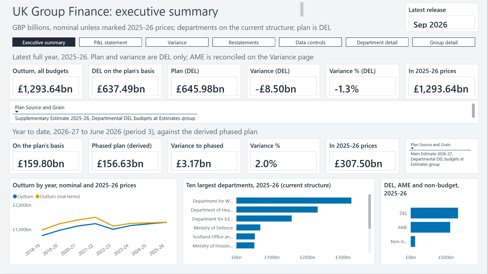
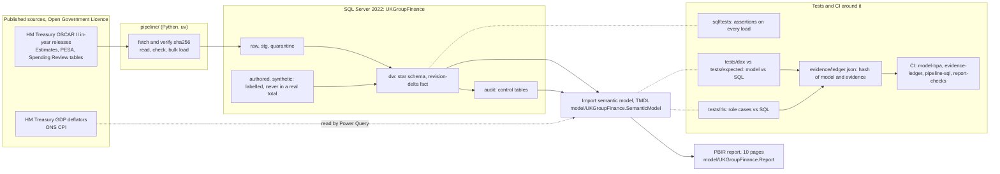
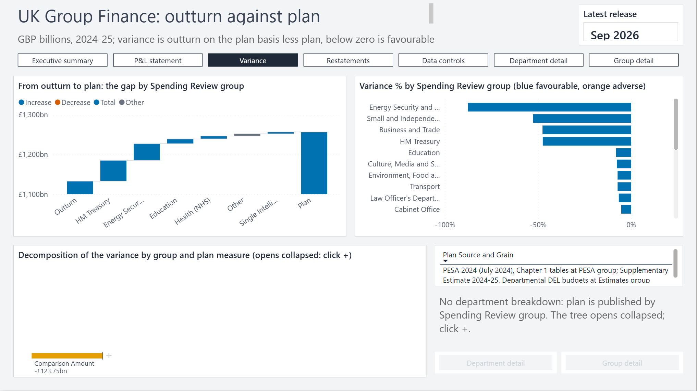
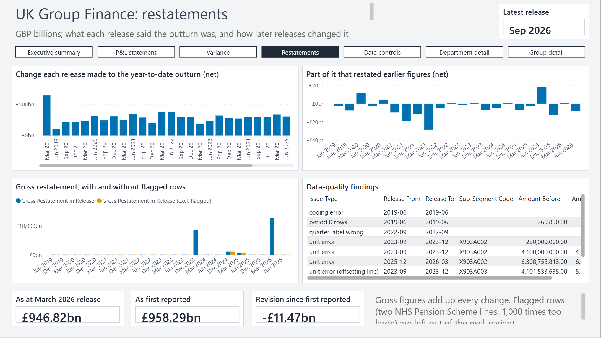
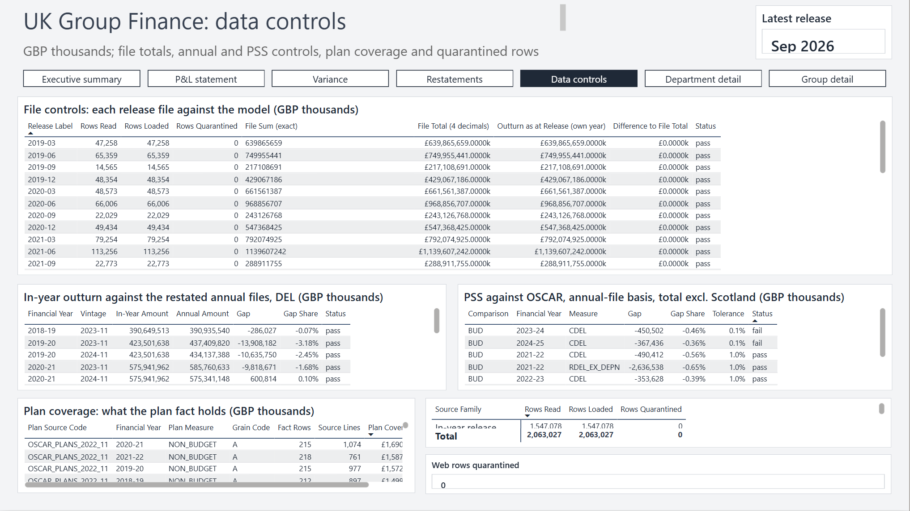
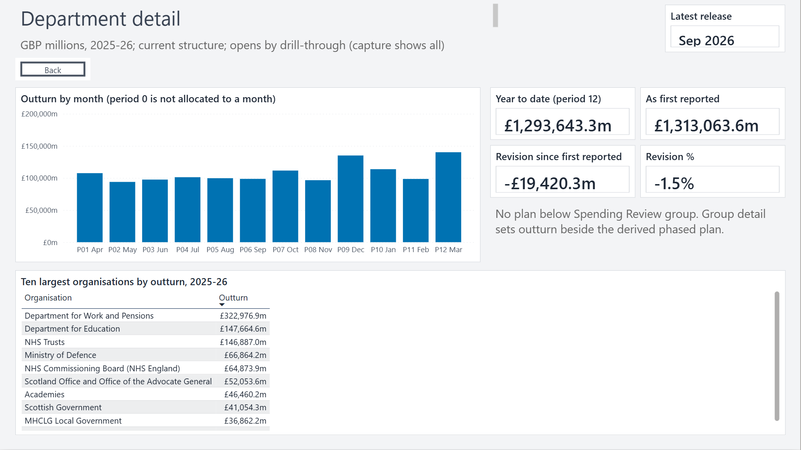
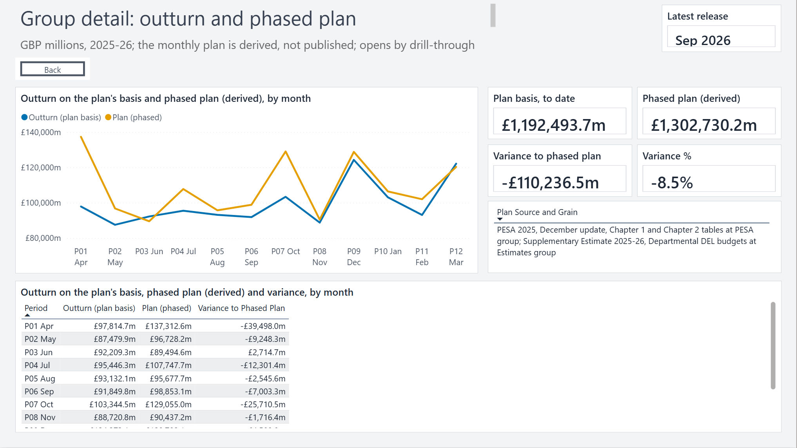
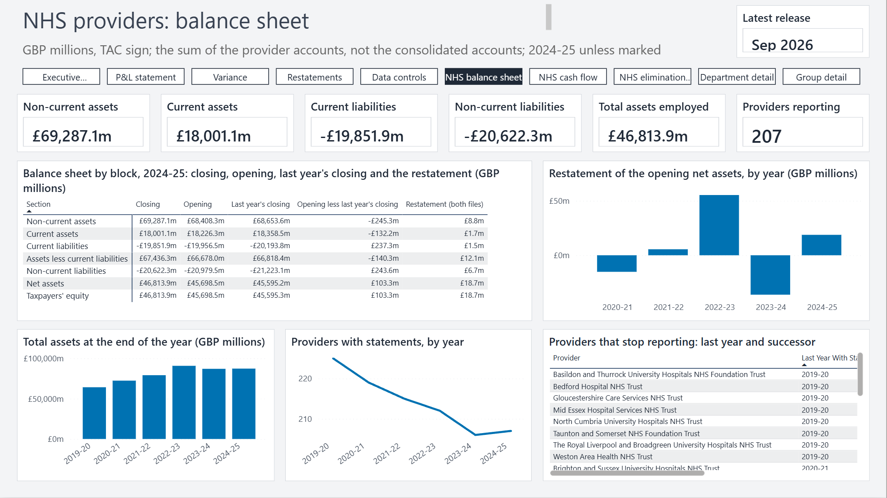
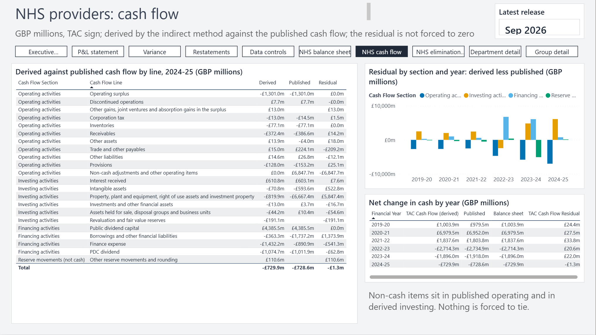
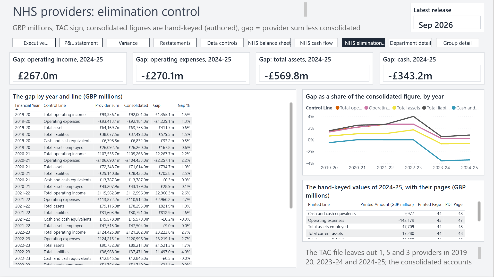

# UK Group Finance Reporting

What would UK central government look like if it reported like a corporate group? I treat HM Treasury's OSCAR II in-year
releases (31 of them, March 2019 to September 2026) as the ledger of one group: departments are business units and their
arm's-length bodies are the entities. On that ledger I built the reporting a group finance team would ask for: an income and
expenditure statement, outturn against plan and against a phased plan, how each figure was restated from release to release,
everything in real terms, and a page of data controls. The plans come from the Estimates and PESA tables, the deflators from
HM Treasury and the CPI from the ONS. The one part of the group with statutory accounts, the NHS trusts and foundation trusts,
adds a balance sheet with its restatements, an indirect cash flow set against the published one, and a control of the sum of
their accounts against the consolidated NHS provider accounts. It is one SQL Server warehouse, one Power BI semantic model and one report, built and
proved in Power BI Desktop alone: no service, no cloud.

I wrote it so that a reader can check it. The totals tie to the published files, every claim in the docs points at the command
and the result file behind it, and where the source is wrong or I could not explain a gap I say so and leave the number in
view.

## Four things to check first

1. **All 31 releases load and tie to the files.** 1,547,078 rows read, none quarantined, and the rows and exact amount sum of
   every file equal the publisher's control totals; the sum of the revision deltas up to each release equals that release's
   file total, difference exactly 0, in 31 of 31 releases. **Tested**:
   [evidence/build/file_control.csv](evidence/build/file_control.csv),
   [evidence/build/delta_invariant.csv](evidence/build/delta_invariant.csv),
   [docs/reconciliation.md](docs/reconciliation.md#1-oscar-in-year-releases-31-releases-committed-scope).
2. **The plan variance is reconciled, and the headline is -1.3%.** My first version led with -8.5% in 2025-26, which compared a
   voted limit (DEL) with a forecast (AME). On DEL only the variance is -8.50bn on a plan of 645.98bn, and every one of the 364
   year, group and measure cells has a verdict: 233 ok, 4 fixed, 120 explained, 7 unexplained, which I list. **Tested**:
   [docs/reconciliation.md](docs/reconciliation.md#9-plan-variance-reconciliation-full-scope),
   [evidence/full/plan_variance_reconciliation.csv](evidence/full/plan_variance_reconciliation.csv),
   [ADR 0007](docs/adr/0007-del-headline-ame-reconciled-separately.md).
3. **Row-level and object-level security is tested against SQL.** Two roles, an invented user map, 136 role cases, 136 equal to
   SQL. **Tested**: [docs/security.md](docs/security.md), [evidence/model/rls_tests.csv](evidence/model/rls_tests.csv).
4. **CI can tell when the evidence is stale.** A hosted runner cannot run DAX, so a ledger records the hash of the model and of
   every test, expected value and result (735 files), and CI fails if any of them changes alone. I pushed a commit that changed
   one measure and nothing else: only the ledger job went red; the commit that restored it was green. **Tested**:
   [docs/evidence.md](docs/evidence.md#the-red-and-the-green-run), [ADR 0008](docs/adr/0008-evidence-ledger-not-dax-in-ci.md).

The model has 128 DAX tests, each compared with a SQL (or Python) expectation that shares nothing with the model, and 128 of
128 pass ([evidence/model/dax_tests.csv](evidence/model/dax_tests.csv)). The 190 figures that the pages display, which I read off
the screenshots, equal the test results ([evidence/report/screenshot_figures.csv](evidence/report/screenshot_figures.csv)).



## How it fits together



Python fetches, parses and loads, and decides nothing about a number; every business transform is T-SQL under
[sql/](sql/README.md). The model reads one view per table and does not reshape anything. The report is built with the `pbir`
command line only. How each stage works: [docs/pipeline.md](docs/pipeline.md), [docs/model.md](docs/model.md),
[docs/pages.md](docs/pages.md). Where each source comes from: [docs/data-sources.md](docs/data-sources.md).

## The ten pages

Eight pages are navigated to and two are reached by drill-through. Page by page, what each shows, which filters are fixed and
which test is behind each figure: [docs/pages.md](docs/pages.md#the-pages).

| | |
|---|---|
| <br>**[Executive summary](docs/pages.md#1-executive-summary)**: the year's outturn against the DEL plan, the variance, the year to date against the phased plan, outturn by year in nominal and 2025-26 prices. | <br>**[P&L statement](docs/pages.md#2-pl-statement)**: the 39 lines of the group income and expenditure statement, with the prior year. |
| <br>**[Variance](docs/pages.md#3-variance)**: plan against outturn by Spending Review group as a bridge, the variance per cent, and the reconciliation table. | <br>**[Restatements](docs/pages.md#6-restatements)**: what each release changed, what it restated, and the rows flagged as source errors. |
| <br>**[Data controls](docs/pages.md#7-data-controls)**: the file controls of the 31 releases, the restated annual files, the Public Spending Statistics, plan coverage. | <br>**[Department detail](docs/pages.md#4-department-detail-drill-through)** (drill-through): a department's outturn by month, its restatement and its ten largest organisations. |
| <br>**[Group detail](docs/pages.md#5-group-detail-drill-through)** (drill-through): a Spending Review group's monthly outturn against my phased plan. | |
| <br>**[NHS balance sheet](docs/pages.md#8-nhs-balance-sheet)**: the closing balance of the NHS providers, the opening as restated, last year's closing and the restatement; a provider that has gone adds nothing after its last year. | <br>**[NHS cash flow](docs/pages.md#9-nhs-cash-flow)**: an indirect cash flow derived from the balance sheets against the published one, line by line, with the residual left in. |
| <br>**[NHS elimination control](docs/pages.md#10-nhs-elimination-control)**: the sum of the provider accounts against the consolidated accounts I keyed by hand, with the page of each value. | |

I did not click through the drill-through pages or the page navigator; the pages render and the files validate, and the
clicks are **designed**, not run ([docs/pages.md](docs/pages.md#things-i-could-not-do-or-check)).

## How I know the numbers are right

- **Every file is checked as it loads.** The sha256 of each committed file equals the manifest. Rows read, loaded and
  quarantined equal the publisher's counts, and the exact amount sum, with up to 31 decimals, equals the control sum with
  tolerance 0. A second control recomputes rows and sums without the readers' code. **Tested**: 31 of 31 releases
  ([reconciliation.md](docs/reconciliation.md#the-chain-source-by-source),
  [data/audit/inyear_independent_control.csv](data/audit/inyear_independent_control.csv)).
- **A control that cannot fail is not a control.** In CI the build plants three errors in a throwaway database (a control total
  one thousand pounds too high, one raw source amount wrong, one fact delta wrong), requires the controls to go red, restores each and
  requires them to go green again. **Tested**: [reconciliation.md](docs/reconciliation.md#the-negative-control).
- **Independent sources.** The restated annual files agree with the in-year releases for DEL at total level in 15 of 15
  year-and-vintage pairs (-3.18% to +3.40%, tolerance 3.5%), and the Public Spending Statistics agree for resource DEL in all
  four years. Capital DEL misses its tolerance in two years, and I cannot say why (below). **Tested**:
  [reconciliation.md](docs/reconciliation.md#known-residuals-published-not-hidden),
  [evidence/full/bud_vs_inyear_del.csv](evidence/full/bud_vs_inyear_del.csv),
  [evidence/full/pss_vs_outturn.csv](evidence/full/pss_vs_outturn.csv).
- **The model is tested against the warehouse.** Each DAX test returns a grid from the model open in Desktop; a SQL or Python
  query over the base tables returns the same grid; `ukfr dax-compare` compares them. **Tested**: 128 of 128
  ([docs/model-testing.md](docs/model-testing.md)).
- **The real facts are pinned.** The row count and sum of each real fact are in
  [evidence/expected/real_fact_totals.csv](evidence/expected/real_fact_totals.csv) and a test compares every build with
  them, so nothing derived, authored or synthetic can move a real total unnoticed. **Tested**:
  `pipeline/tests/test_real_totals.py`, `sql/tests/558_nothing_derived_reaches_a_real_total.sql`.
- **The ledger.** [docs/evidence.md](docs/evidence.md) says what CI checks, and as plainly what it cannot: it proves that the
  evidence in git is the evidence that was compared and passed together, not that a result file came from Desktop.
- **The whole pipeline test suite.** 571 passed, 0 failed, 0 skipped against the full-scope database
  ([evidence/full/pytest_summary.csv](evidence/full/pytest_summary.csv)). CI runs the committed-scope part of it, and the
  model's Best Practice Analyzer rules, on every pull request ([docs/pipeline.md](docs/pipeline.md#continuous-integration)).
- **One performance claim, with its failure.** Rewriting the year-to-date variance rank cut its cold time from 259 to 154 ms
  (and from 203 to 111 ms over three years); rewriting the as-at measure in three forms did not make it faster, and the page
  says so. **Tested**: [docs/performance.md](docs/performance.md).

## Register of real, authored, derived and synthetic data

Real data only in real totals. An object is one of four classes:

- **real**: a published number, loaded as it was published;
- **authored**: a table I wrote by hand because no source publishes it (a key, a name, a mapping); it holds no
  amount;
- **derived**: computed from real data by a stated rule or allocation (a regrouping, a monthly phasing); it is
  flagged as derived in the database wherever it could be mistaken for data, and never added to a real total;
- **synthetic**: invented data. There are two tables: the map of invented users to departments that drives the security
  roles (`synthetic.user_department`, 11 rows, below) and five invented what-if settings (`synthetic.whatif_parameter`, below).
  Neither holds an amount, only three views read them, and no real fact or total reads those. Nothing of this class may be added without its own file, a row here and a test. **Tested**:
  `pipeline/tests/test_register.py::test_the_synthetic_schemas_hold_exactly_the_registered_tables_and_no_fact_or_total_view_reads_them`
  (the `synthetic` and `scale` schemas hold exactly the registered tables, and the only objects that read them are the two
  role views and the what-if view, which nothing reads), `sql/tests/821_only_the_two_role_views_read_the_synthetic_table_and_nothing_reads_them.sql`
  and `pipeline/tests/test_synthetic.py` (the pinned totals of the real facts hold with the map loaded).

Every authored file is in the table. **Tested**: `pipeline/tests/test_register.py` fails if an `authored/*.csv`
file is missing from it, if the row count shown differs from the file, or if a row of class authored, derived or
synthetic does not say no to reaching a real total. The database labels every authored table in its description
(`sql/tests/200_authored_tables_are_labelled.sql`). Row counts are from a committed-scope build
(`evidence/build/table_counts.csv`); where a full-scope build differs it is shown in brackets.
The two CSV files under `te/` (`te/scripts/perspectives.csv` and `te/bpa/ignores.csv`) are metadata about the semantic
model, not data: they hold no amount, never reach the warehouse and are not in the table. The model's own authored tables are
labelled AUTHORED in their descriptions and in a display folder, and a rule of the analyzer fails the build if one is not
(`te/bpa/README.md`).

| Object or file | Class | Schema and table | Rows | What it holds | Can it reach a real total | Test |
|---|---|---|---|---|---|---|
| `authored/account_flow.csv` | authored | `authored.account_flow` | 12 | whether each economic category that the digit rule cannot settle is Expenditure, Income or Not applicable | no: a label on an account, no amount | `sql/tests/308_every_economic_category_has_one_budget_and_one_flow.sql` |
| `authored/current_structure_map.csv` | authored | `authored.current_structure_map` | 20 | the department a line belongs to in the current structure where the rules cannot decide: the review of the BEIS sub-segments, three lines left in DSIT, the departments that closed into another | no: it moves a line between departments, every line keeps its amount and the total is unchanged | `sql/tests/453_current_structure_authored_rows_are_live_unique_and_applied.sql`, `sql/tests/452_current_structure_current_totals_equal_reported_and_snapshot.sql` |
| `authored/department_name.csv` | authored | `authored.department_name` | 75 | the display name of each department number in each naming period, including the four Unallocated members | no: names and periods only | `sql/tests/203_department_periods_are_well_formed.sql`, `sql/tests/205_published_department_labels_belong_to_their_period.sql` |
| `authored/department_sr_group.csv` | authored | `authored.department_sr_group` | 63 | which Spending Review group a current department belongs to, one organisation exception (department 085) and the departments of the combined pre-2023 group | no: it decides which group a real line is added to; the regrouped lines add back to the fact exactly | `sql/tests/551_bridge_follows_the_authored_department_rule.sql`, `sql/tests/550_every_outturn_line_has_exactly_one_sr_group.sql` |
| `authored/organisation_key_override.csv` | authored | `authored.organisation_key_override` | 14 | the durable key a code gets where its three-letter prefix is not enough | no: a key, never an amount | `sql/tests/210_overrides_are_well_formed.sql`, `sql/tests/211_every_override_is_used.sql` |
| `authored/plan_name_map.csv` | authored | `authored.plan_name_map` | 97 | which plan member a published plan name belongs to, with confidence and evidence | no: a map of names; the plan amounts are the published ones | `sql/tests/505_plan_lines_all_mapped.sql`, `sql/tests/512_authored_data_never_reaches_a_total.sql` |
| `authored/plan_source.csv` | authored | `authored.plan_source` | 17 | each plan source and edition: its basis, whether it is the final plan, what it covers | no: descriptions of sources, no amount | `sql/tests/512_authored_data_never_reaches_a_total.sql` |
| `authored/sr_group.csv` | authored | `authored.sr_group` | 32 | the 23 Spending Review groups of the latest annual release, the Single Intelligence Account (plan only), the combined pre-2023 group, six non-department members and the outturn-only member for former department lines | no: names and types, no amount | `sql/tests/506_sr_group_members.sql`, `sql/tests/512_authored_data_never_reaches_a_total.sql` |
| `authored/statement_account_rule.csv` | authored | `authored.statement_account_rule` | 31 | which detail line of the income and expenditure statement each economic category is added to: rules on economic budget, flow, PESA group or category, the most specific rule winning | no: it decides which line a real amount is added to, and every account has exactly one line, so the statement total equals `Outturn` | `sql/tests/740_every_account_maps_to_exactly_one_statement_line.sql`, `sql/tests/741_the_statement_total_equals_outturn_in_every_year.sql` |
| `authored/statement_line.csv` | authored | `authored.statement_line` | 39 | the layout of the statement: line, order, type, the sign it is presented in, indent, the lines a subtotal adds up and the plan scope it is compared with | no: names, order and lists of lines; a subtotal is the sum of its members and a spacer has no amount | `sql/tests/742_a_subtotal_is_the_sum_of_its_members.sql`, `sql/tests/743_a_line_with_a_plan_scope_holds_exactly_the_accounts_of_that_budget.sql` |
| `authored/tac_code_map.csv` | authored | `authored.tac_code_map` | 4 | the sub codes of the NHS TAC forms that were retired or changed meaning between years (one retired, three relabelled), with the form wording as evidence | no: it labels a line across years and holds no amount | `sql/tests/111_tac_the_code_map_matches_the_forms_and_the_data.sql`, `sql/tests/114_tac_authored_data_never_reaches_a_total.sql` |
| `authored/tac_name_alias.csv` | authored | `authored.tac_name_alias` | 3 | three provider-years where the TAC data sheet names a provider differently from the same file's list of providers (the data uses the later name), so the join by name needs the code | no: a name for a name, no amount | `sql/tests/115_tac_a_name_alias_is_needed_and_resolves_to_one_provider.sql`, `sql/tests/114_tac_authored_data_never_reaches_a_total.sql` |
| `authored/tac_line_role.csv` | authored | `authored.tac_line_role` | 137 | for each line of the NHS TAC income statement, balance sheet and cash flow: its section and whether the form computes it (line, subtotal or total) | no: a section and a kind on a line, no amount | `sql/tests/110_tac_every_line_has_text_sign_section_and_kind.sql`, `sql/tests/114_tac_authored_data_never_reaches_a_total.sql` |
| `authored/tac_provider_successor.csv` | authored | `authored.tac_provider_successor` | 23 | where an NHS trust or foundation trust went when it was acquired, merged or dissolved, with a quotation from the source's own comment | no: a link between two providers, no amount | `sql/tests/112_tac_successor_evidence_is_in_the_source_comment.sql`, `sql/tests/114_tac_authored_data_never_reaches_a_total.sql` |
| `authored/tac_cash_flow_line.csv` | authored | `authored.tac_cash_flow_line` | 22 | the lines of the derived (indirect) cash flow of the NHS providers: label, section and whether the line is compared with a published cash-flow line, exists only on the derived side or only on the published side | no: labels and sections, no amount | `sql/tests/150_tac_cash_flow_map_covers_every_line_and_follows_its_rules.sql`, `sql/tests/155_tac_derived_and_authored_amounts_never_reach_a_real_total.sql` |
| `authored/tac_cash_flow_map.csv` | authored | `authored.tac_cash_flow_map` | 148 | for each line of the NHS TAC statements: whether it feeds the derived cash flow (a balance-sheet movement or an income-statement flow, with its factor) or is compared with it, and a note | no: it decides which derived line a real amount is added to; the result is `dw.tac_cash_flow_derived`, which no real total reads | `sql/tests/150_tac_cash_flow_map_covers_every_line_and_follows_its_rules.sql`, `sql/tests/153_tac_derived_cash_flow_equals_its_inputs_recomputed.sql` |
| `authored/tac_control_line.csv` | authored | `authored.tac_control_line` | 6 | the six headline lines of the elimination-gap control (operating income, operating expenses, total assets, total liabilities, cash, total assets employed): the provider statement lines and the printed consolidated lines each is made of | no: names and lists of lines, no amount | `sql/tests/157_tac_control_lines_are_made_of_lines_and_equal_their_subtotals.sql`, `sql/tests/155_tac_derived_and_authored_amounts_never_reach_a_real_total.sql` |
| `authored/tac_consolidated_control.csv` | authored | `authored.tac_consolidated_control` | 48 | hand-keyed: eight lines of the consolidated NHS provider accounts (GBP million, as printed) in each of six years, with the printed and PDF page of each and the figure the next year's report gives for the same year | no: the only authored amounts of the TAC objects; the gap is a difference of the provider sum and these values, and no total adds them to a provider amount | `sql/tests/156_tac_consolidated_control_is_complete_cross_checked_and_paged.sql`, `sql/tests/155_tac_derived_and_authored_amounts_never_reach_a_real_total.sql` |
| `dw.tac_fact` | real | `dw.tac_fact` | 344,812 (full scope only) | the published statements of the NHS trusts and foundation trusts, GBP thousands, on the TAC sign | yes: published figures; its row count and sum are pinned in `evidence/expected/real_fact_totals.csv` | `pipeline/tests/test_real_totals.py`, `sql/tests/155_tac_derived_and_authored_amounts_never_reach_a_real_total.sql` |
| `dw.tac_cash_flow_derived` | derived | `dw.tac_cash_flow_derived` | 28,248 (full scope only) | the indirect cash flow of each NHS provider and year, from balance-sheet movements and income-statement flows through `authored/tac_cash_flow_map.csv`; compared with the published cash flow, never forced to equal it | no: flagged `is_derived`, described as DERIVED, read only by its model view and the audit tables that compare it | `sql/tests/153_tac_derived_cash_flow_equals_its_inputs_recomputed.sql`, `sql/tests/155_tac_derived_and_authored_amounts_never_reach_a_real_total.sql` |
| `dw.tac_cash_flow_line`, `dw.tac_cash_flow_comparison`, `dw.tac_control_line`, `dw.tac_control_member` | authored | the same four tables, resolved from the authored files | 22; 51; 6; 54 | the derived cash-flow lines, which derived line each published line is compared with, the control lines and their provider lines | no: labels and keys, no amount | `sql/tests/150_tac_cash_flow_map_covers_every_line_and_follows_its_rules.sql`, `sql/tests/157_tac_control_lines_are_made_of_lines_and_equal_their_subtotals.sql` |
| `dw.tac_consolidated_control` | authored | `dw.tac_consolidated_control` | 48 | the hand-keyed consolidated values in GBP thousand (the printed GBP million times 1,000) | no: read only by its model view and the elimination-gap tables; the gap is a difference, never a sum | `sql/tests/155_tac_derived_and_authored_amounts_never_reach_a_real_total.sql`, `tests/dax/163_tac_derived_and_authored_amounts_stay_out_of_real_totals.dax` |
| Model table `Fact TAC Cash Flow (derived)` | derived | `dw.tac_cash_flow_derived` through `dw.v_model_tac_cash_flow_derived` | 28,248 | the model's copy of the derived cash flow, named, described and foldered as derived | no: related to the provider and the derived line only; no measure of a real family reads it, and test 163 shows the real totals equal their own tables | `tests/dax/163_tac_derived_and_authored_amounts_stay_out_of_real_totals.dax` |
| Model tables `TAC Cash Flow Line`, `TAC Control Line`, `TAC Control Member`, `TAC Consolidated Accounts` | authored | `dw.v_model_tac_cash_flow_line`, `v_model_tac_control_line`, `v_model_tac_control_member`, `v_model_tac_consolidated` | 23; 6; 54; 48 | the authored dimensions and the hand-keyed values as model tables, described AUTHORED and in the Authored folder | no: the consolidated amount column is hidden and read by one measure family that compares it with the provider sum | `tests/dax/150_tac_row_counts.dax`, `tests/dax/162_tac_elimination_gap_by_year_and_control_line.dax` |
| Model measures of the NHS trust accounts (display folders `TAC\...`) | derived | none: measures over `Fact TAC`, `Fact TAC Cash Flow (derived)` and `TAC Consolidated Accounts` | 16 | closing, opening and prior-year balances, restatement, flows, the published and derived cash flow, the residual, and the elimination gap | no: each is a sum, a difference or a ratio of its own tables; a subtotal is never added to its lines | `tests/dax/152_tac_closing_balance_by_year_and_section.dax` to `tests/dax/163_tac_derived_and_authored_amounts_stay_out_of_real_totals.dax` |
| `authored/workforce_org_map.csv` | authored | `authored.workforce_org_map` | 213 | for each organisation name a department publishes in its workforce files: the durable organisation key it is (the same body, an earlier or later name, a body that is part of it, or an executive agency counted in its parent department, which is an assumption), or that I reviewed it and left it out, with the reason | no: it says which organisation a published number belongs to and holds no number | `sql/tests/607_workforce_org_map_rows_are_well_formed.sql`, `sql/tests/613_workforce_the_fact_is_the_raw_values_of_mapped_rows_and_nothing_else.sql` |
| `dw.statement_line`, `dw.statement_line_member`, `dw.account_statement_line` | authored | the same three tables, resolved from the two statement files | 39; 110; 128 | the statement lines, every detail line each line adds up, and the detail line of each account | no: no amount column of any type | `sql/tests/745_the_statement_layout_is_authored_and_adds_no_amount.sql` |
| `dw.v_statement_pnl` | derived | a view over `dw.fact_outturn` and `dw.fact_plan` through the statement tables | one row per line and year with an amount or a plan | the statement computed in SQL, which the model's statement measures are tested against; the model never reads it | no: it reads the facts and writes nothing; its total line equals the sum of the fact in every year | `sql/tests/741_the_statement_total_equals_outturn_in_every_year.sql` |
| Model table `Statement Line` | authored | `dw.statement_line` through `dw.v_model_statement_line` | 39 | the statement layout as a dimension; Account is related to it | no: it holds no amount | `sql/tests/700_model_views_have_the_rows_of_their_base_tables.sql` |
| Model table `Statement Measure` (field parameter) | authored | none: a calculated table of four `NAMEOF` rows | 4 | the four statement measures a visual can switch between | no: it holds no amount and filters nothing | `tests/dax/750_statement_measure_parameter_rows.dax` |
| `authored.pss_sr_group_alias` (created in `sql/authored/400_pss_sr_group_alias.sql`) | authored | `authored.pss_sr_group_alias` | 3 (full scope only) | three names the Public Spending Statistics use for a Spending Review group that OSCAR writes differently | no: it decides which OSCAR group a PSS row is compared with, and holds no amount | `sql/tests/411_pss_sr_group_map_complete.sql` |
| the Unallocated department members | authored | `dw.dim_department` | 4 of 76 (U011, U035, U077, U084) | a home for the lines of a closed or split department that no current department took over (the Electoral Commission, the Assets Recovery Agency, Exiting the EU, the BEIS shared lines) | no: the member adds no amount; its lines are real outturn, counted once | `sql/tests/451_current_structure_unallocated_members_are_whole_and_exist.sql` |
| the Unallocated Spending Review members | authored | `dw.dim_sr_group` | 2 of 32 (`Unallocated central funds` for plans, `Unallocated: former department lines` for outturn) | two members that are not departments: funds the plans have not allocated, and the outturn lines of former departments. The first has no outturn line, the second has no plan row | no: neither adds an amount; no outturn line is in `Unallocated central funds` | `sql/tests/550_every_outturn_line_has_exactly_one_sr_group.sql`, `sql/tests/506_sr_group_members.sql` |
| `dw.outturn_sr_group_bridge` | derived | `dw.outturn_sr_group_bridge` | 5,480 | the Spending Review group of each organisation version and sub-segment pair, by the current department and the authored rule | no: a mapping that holds no amount | `sql/tests/550_every_outturn_line_has_exactly_one_sr_group.sql` |
| `dw.outturn_plan_line` and the plan-basis outturn tables | derived | `dw.outturn_plan_line`, `dw.outturn_plan_basis_inyear`, `dw.outturn_plan_basis_annual` | 101,675; 34,048; 1,020 (annual, full scope only) | real outturn regrouped to the plan's groups and measures | no: they add back to `dw.fact_outturn` in total and in every release and are not a second source of the number | `sql/tests/550_every_outturn_line_has_exactly_one_sr_group.sql`, `sql/tests/556_inyear_plan_basis_equals_the_fact_selection_at_every_release.sql` |
| `dw.forecast_own_pay`, `dw.forecast_pay_input`, `dw.forecast_pay_prior_profile`, `dw.forecast_fte_cost_input` | derived | the same four tables | 32,892; 21,361; 2,883; 582 (full scope only) | my run-rate, seasonal and FTE x cost forecasts of the pay line (A101 of RDEL) of each department group, and the inputs they read: the pay line of the returns and the workforce of the last actual month | no: forecasts read only the returns and the workforce already in the pay bridge; no total adds them to a return or an outturn | `sql/tests/920_fte_cost_reads_only_the_last_actual_month_and_forecasts_exactly_the_months_after_it.sql`, `sql/tests/921_fte_cost_forecast_equals_an_independent_recompute_from_the_raw_workforce_rows.sql` |
| `dw.forecast_pay_month_compare`, `dw.forecast_pay_accuracy`, `audit.forecast_fte_cost_coverage`, `audit.forecast_fte_cost_cover_band` | derived | the same four tables | 114,516 (month compare); 9,543; 2,955; 8 (full scope only) | the scores of the four methods on the pay line and the coverage of FTE x cost by department group, year and return | no: scores and counts, read only by the model view and the audit | `sql/tests/923_forecast_pay_accuracy_recomputed_by_a_second_route.sql`, `sql/tests/925_fte_cost_cover_band_table_equals_a_recompute_from_the_inputs.sql`, `sql/tests/924_forecast_model_views_keep_every_row_and_amount_resolve_every_key_and_read_real_data_only.sql` |
| Model table `Fact Forecast Accuracy (derived)`, and `Forecast Method`, `Forecast Return` | derived | `dw.v_model_forecast_accuracy`, `dw.v_model_forecast_method`, `dw.v_model_forecast_return` | 33,619; 4; 13 | the model's copy of the forecast scores, named, described and foldered as derived; two label tables | no: related to the department, year, method and return only; the measures are ratios and absolute errors in GBP thousands that no total of a real fact reads | `tests/dax/920_forecast_model_table_row_counts.dax`, `sql/tests/924_forecast_model_views_keep_every_row_and_amount_resolve_every_key_and_read_real_data_only.sql` |
| `authored.allocation_rule` (created in `sql/authored/940_allocation_rule.sql`) | authored | `authored.allocation_rule` | 1 (full scope only) | my own allocation rule, not a government policy: the pool (the Cabinet Office administration budget of DEL), the basis (payroll full-time equivalent), the years 2018-19 to 2025-26, the minimum of 9 months of workforce data, the rounding rule, why, and what it is not | no: it names a pool and holds no amount; the pool amount is read from the real outturn into `dw.allocation_pool` | `sql/tests/941_the_allocation_rule_is_authored_labelled_and_names_a_pool_that_exists.sql` |
| `dw.allocation_pool`, `audit.allocation_participation`, `dw.fact_allocation`, `audit.allocation_year_summary` | derived | the same four tables | 8; 121; 108; 8 (full scope only) | the pool of each year (the real outturn of the Cabinet Office in DEL administration), which departments take part in each year and the weight a department left out would have had, my allocation of the pool by payroll full-time equivalent with its rounding adjustment and annualised paybill, and the tie of the allocated amounts to the pool | no: described as DERIVED, read only by their model views and the audit; none carries an `is_derived` column and no real fact or total reads them | `sql/tests/942_the_pool_equals_the_last_release_of_the_year_summed_by_a_second_route.sql`, `sql/tests/943_the_weights_equal_a_second_computation_from_the_raw_workforce_rows_and_add_to_one.sql`, `sql/tests/944_allocated_amounts_add_up_to_the_pool_taken_from_the_release_snapshot_and_the_rounding_is_one_stated_row.sql`, `sql/tests/946_the_allocation_reads_real_data_and_nothing_real_reads_the_allocation.sql` |
| Model tables `Allocation Bridge (derived)` and `Allocation Coverage (derived)`, and `Allocation Rule` | derived; authored for the rule | `dw.v_model_allocation_bridge`, `v_model_allocation_coverage`, `v_model_allocation_rule` | 108; 8; 1 | the weighted bridge between the pool and the departments (the year's pool is stored on its rows, so no user sees it except through a department the user can see), the counts of who is left out, and the authored rule, named, described and foldered as derived or authored | no: related to the fiscal year, the department and the rule only; `Outturn` and every other real measure never read them, and test 955 guards that the real outturn is unchanged with the allocation tables in the filter context | `tests/dax/950_allocation_model_table_row_counts.dax`, `tests/dax/955_outturn_is_unchanged_with_the_allocation_tables_in_context.dax`, `sql/tests/947_allocation_model_views_keep_every_row_and_amount_and_resolve_every_key.sql` |
| Model measures of the allocation (display folder `Allocation`), and the hidden `Allocated Amount (naive)` | derived | none: measures over the three allocation tables | 12 and 1 | the allocated amount, its weight, the pool, the gap between them, the rounding adjustment, the annualised paybill and the coverage counts; the hidden plain form kept as the evidence of slow measure 3 | no: each is a sum, a difference or a ratio of its own tables | `tests/dax/951_allocation_by_department_and_year.dax`, `tests/dax/954_allocation_tie_and_coverage_by_year.dax`, `tests/dax/952_each_form_of_allocated_amount_equals_its_own_recompute_by_department_and_year.dax` |
| `dw.plan_phasing_profile` | derived | `dw.plan_phasing_profile` | 8,988 (53,688 full scope) | twelve monthly shares per annual plan, from the prior year's outturn; not published | no: flagged `is_derived = 1`, described as DERIVED, and no real fact reads it | `sql/tests/558_nothing_derived_reaches_a_real_total.sql`, `sql/tests/552_profile_shares_sum_to_one_and_cover_twelve_periods.sql` |
| `dw.fact_plan_phased` | derived | `dw.fact_plan_phased` | 8,988 (53,688 full scope) | each plan row spread over the twelve months by its profile, scenario `Plan (phased)` | no: flagged `is_derived = 1`; the twelve months add to the plan exactly and no view, procedure or key points at it | `sql/tests/558_nothing_derived_reaches_a_real_total.sql`, `sql/tests/555_phased_plan_sums_to_the_plan_exactly.sql` |
| `dw.fact_outturn` | real | `dw.fact_outturn` | 658,554 | the revision deltas of the 31 in-year releases, GBP thousands | yes: this is the real outturn; its row count and sum are pinned in `evidence/expected/real_fact_totals.csv` | `pipeline/tests/test_real_totals.py`, `sql/tests/302_delta_total_equals_the_control_total.sql` |
| `dw.fact_plan` | real | `dw.fact_plan` | 749 (5,372 full scope) | the published plans: Estimates, PESA and, in full scope, OSCAR Plans | yes: published figures, grouped through the authored name map | `pipeline/tests/test_real_totals.py`, `sql/tests/509_fact_plan_ties_to_published_totals.sql` |
| `dw.fact_outturn_annual` | real | `dw.fact_outturn_annual` | 97,250 (full scope only) | the restated annual outturn of the November 2023, 2024 and 2025 releases | yes: published figures | `pipeline/tests/test_real_totals.py`, `sql/tests/404_bud_fact_sums_equal_excluding_closed.sql` |
| Model table `Fact Plan Phased (derived)` | derived | `dw.fact_plan_phased` through `dw.v_model_fact_plan_phased` | 53,688 | the model's copy of the phased plan; named, described and foldered as derived, with `Is Derived` and the method on every row | no: it is related to scenario Plan (phased), the model has no measure that adds it to Plan or Outturn, and the model tests count its rows apart from the real facts | `sql/tests/706_only_the_derived_model_view_reads_the_phased_plan.sql`, `pipeline/tests/test_model_files.py::test_derived_and_real_tables_are_labelled` |
| Model function `Basis.OutturnFor`, the rules for `NON_DEPT_AME`, `NON_BUDGET` and `UNCLASSIFIED` | authored | none: a rule inside the model (`functions.tmdl`) | 3 rules | which outturn lines each of three OSCAR Plans measures is compared with; `dw.plan_measure_selection` does not define them | no: it selects real outturn lines and holds no amount; the other seven rules are those of `dw.plan_measure_selection` | `tests/dax/735_outturn_plan_basis_other_measures.dax` |
| Model measure `Plan (phased)` | derived | reads the phased plan only | 1 measure | the phased plan summed for the plan rows `Plan` adds up | no: it is the only measure that names the phased table, `Outturn` and `Plan` never read it, and test 733 shows their totals equal their own facts | `pipeline/tests/test_model_measures.py::test_the_derived_phased_plan_is_read_by_one_measure_and_by_no_other`, `tests/dax/733_phased_plan_never_reaches_outturn_or_plan.dax` |
| Model member `No issue flagged` of `Data Quality Issue` | authored | `dw.v_model_data_quality` | 1 of 7 | a label, so that every outturn row has a data-quality key that exists | no: it holds no amount and flags no fact row | `sql/tests/703_model_data_quality_view_adds_only_the_no_issue_member.sql` |
| Model table `Deflator` (read over the web) | real | none: read in Power Query from the manifest links | 229 | HM Treasury GDP deflators (2025-26 = 100) for three vintages: the published index and per cent change, and a chained index in which a forecast year is the previous level moved by its published per cent change | yes, where a measure converts to real terms: the figures are published, and the chained forecast levels are arithmetic on published changes, marked by `Year Status`; real terms use one vintage | `tests/dax/703_deflators.dax` |
| Model table `CPI` (read over the web) | real | none: read in Power Query from the manifest links | 918 to September 2026 (more as ONS publishes) | ONS CPI index (D7BT) and annual rate (D7G7), monthly | yes, where a measure uses it: published figures | `tests/dax/704_cpi.dax` |
| `dw.department_reported_number` and the model column `Reported Department Numbers` | derived | `dw.department_reported_number` through `dw.v_model_department` | 63 | the department of the current structure that answers for each department number the outturn was reported under: its own number, an Unallocated member, or (for 027 only) the department that receives the lines | no: a mapping of numbers to departments; `reported_net_amount` is a note of what the number was reported with, no measure reads it, and the amounts of the as-reported structure added over the departments equal the total | `sql/tests/760_every_reported_department_number_has_exactly_one_current_department.sql`, `tests/dax/764_structure_totals_by_year.dax` |
| Model measures of the restatement and the current structure (display folders `Restatement` and `Current Structure`) | derived | none: measures over `Fact Outturn` | 15 | the outturn as at a release, as first reported, the revisions between releases, the figure under each department structure and the transfer between them | no: each is a sum, a difference or a ratio of the real deltas; the transfer adds to zero over the departments in every year and release | `tests/dax/760_as_at_release_equals_file_total.dax`, `tests/dax/764_structure_totals_by_year.dax`, `tests/dax/765_structure_totals_by_release.dax` |
| Model measures of real terms (display folder `Real Terms`) | derived | none: measures over `Fact Outturn`, `Fact Plan` and `Fact Plan Phased (derived)` | 7 | outturn, plan and statement amounts in 2025-26 prices: each financial year's amount times the index of 2025-26 over the index of that year, from the October 2026 Budget deflators; the phased twin is labelled DERIVED | no: each is a separate measure, the nominal measures and every real total are unchanged, and a year without an index gives BLANK, never the nominal figure | `tests/dax/770_real_terms_outturn_by_year.dax`, `tests/dax/773_real_terms_2025_26_is_nominal.dax`, `tests/dax/776_real_terms_year_without_index_is_blank.dax` |
| `synthetic/user_department.csv` | synthetic | `synthetic.user_department` | 11 | invented users (addresses at `example.org`) and the departments of the current structure each may see: eight users, one with two departments, one with three, one whose department has outturn in six of nine years; a ninth user, `nobody@example.org`, is in no row on purpose | no: it filters rows for the security roles and holds no amount; only `dw.v_model_user_department` and `dw.v_model_user_plan_group` read it and nothing reads those | `sql/tests/821_only_the_two_role_views_read_the_synthetic_table_and_nothing_reads_them.sql`, `pipeline/tests/test_synthetic.py`, `sql/tests/820_the_user_map_is_synthetic_labelled_and_has_the_cases_the_roles_are_tested_with.sql` |
| `dw.v_model_user_department` and `dw.v_model_user_plan_group` | synthetic | two views over `synthetic.user_department` | 11; 10 | one row per user and department, and one row per user and Spending Review group whose departments the user holds in full (the rule that decides which plan a user sees) | no: no amount column; no fact, view of a fact or measure reads them, the roles read them by key | `sql/tests/822_a_user_sees_the_plan_of_a_group_only_when_every_department_of_the_group_is_the_users.sql`, `sql/tests/823_the_named_users_see_the_groups_the_security_document_says.sql` |
| Model table `User Department (synthetic)` | synthetic | `dw.v_model_user_department` | 11 | the user map as a hidden model table; the two roles filter the department dimension by it | no: hidden, related to nothing, no amount; the unrestricted totals equal SQL with it loaded | `tests/dax/820_user_department_rows.dax`, `tests/dax/822_unrestricted_totals_with_the_user_map_loaded.dax` |
| Model table `User Plan Group (synthetic)` | synthetic | `dw.v_model_user_plan_group` | 10 | the groups whose plan each user may see, as a hidden model table; the two roles filter the plan facts by it | no: hidden, related to nothing, no amount; the unrestricted totals equal SQL with it loaded | `tests/dax/821_user_plan_group_rows.dax`, `tests/dax/822_unrestricted_totals_with_the_user_map_loaded.dax` |
| `synthetic/whatif_parameter.csv` | synthetic | `synthetic.whatif_parameter` | 5 | five invented what-if settings, each a pay award and a headcount change in per cent: the base pay award is the ONS CPI annual rate (series D7G7) for 2025, 3.4 per cent, from the file the repository holds; every other percentage is invented and says so | no: it holds percentages and no amount; only `dw.v_model_whatif_setting` reads it and nothing reads that view | `sql/tests/940_whatif_settings_are_synthetic_labelled_and_read_only_by_their_model_view.sql`, `pipeline/tests/test_synthetic.py`, `tests/dax/957_real_totals_are_identical_at_every_whatif_setting.dax` |
| `dw.v_model_whatif_setting` | synthetic | a view over `synthetic.whatif_parameter` | 5 | one row per what-if setting, for the model | no: no amount column; no fact, view of a fact or real measure reads it | `sql/tests/940_whatif_settings_are_synthetic_labelled_and_read_only_by_their_model_view.sql` |
| Model table `What-if Setting (synthetic)` and its measures (display folder `What-if (synthetic)`) | synthetic | `dw.v_model_whatif_setting` | 5 rows; 7 measures | the settings as a table related to nothing, and the measures that apply the setting in context to the allocated amount and the annualised paybill | no: the table is related to nothing and only the what-if measures read it; the real outturn, the plan rows, the allocated amount and the paybill are the same at every setting | `tests/dax/956_whatif_measures_at_every_setting_2025_26.dax`, `tests/dax/957_real_totals_are_identical_at_every_whatif_setting.dax` |

## Limitations and known source errors

These are the gaps I know about. Each is in the docs with its evidence; none is hidden in a total.

- **A unit error in the source.** One NHS Pension Scheme line (`NHP903 X903A002`) is 1,000 times too large in three
  line-months, each corrected by a later release, and its offsetting line (`X903A003`) moves with it. `dw.dq_issue` holds nine
  findings and flags thirteen fact rows. Without the flag the gross restatement of December 2023 would be 8,645bn; with the
  flagged rows left out it is 13.9bn. The restatement measures have an `(excl. flagged)` variant and the page shows both.
  **Tested**: `sql/tests/309`, `310`; [docs/pages.md](docs/pages.md#6-restatements).
- **Seven plan cells I could not explain.** Of the 364 cells of the plan variance reconciliation, seven stay `unexplained`,
  each under 1bn (0.1bn to 0.66bn against the annual file), none a headline item. They are named, and a test pins exactly
  those seven. [reconciliation.md](docs/reconciliation.md#9-plan-variance-reconciliation-full-scope).
- **Home Office fee income is missing from the in-year files.** It is 1.11bn in the in-year files and 6.18bn in the annual file
  in 2024-25 for one fee category, and it explains a gap of 3.5 to 5.3bn a year in the Home Office's DEL. I do not know why the
  in-year files lack it. The 2025-26 figure is carried forward from 2024-25 because no annual file for 2025-26 exists, so it is
  explained, not measured.
- **Two capital DEL checks fail.** The Public Spending Statistics differ from the annual outturn for capital DEL (excluding
  Scotland) by -0.46% in 2023-24 and -0.36% in 2024-25, against a tolerance of 0.1%. The cause is unknown. A test pins these two
  as the only failures, so a third one fails the build ([reconciliation.md](docs/reconciliation.md#known-residuals-published-not-hidden)).
- **A department-structure gap I have not traced.** On the current structure, the in-year outturn of DSIT is about 45% below the annual file in 2021-22 and
  2023-24 for all budgets, though within 2.1% for DEL. The gap is in layers that the annual file carries and the in-year file
  does not; I did not trace it.
- **The as-at rewrite gained nothing.** I rewrote `Outturn as at Release` in three forms. None was faster than the plain one
  beyond the spread of the runs, and the trace shows both forms are the same plan ([docs/performance.md](docs/performance.md)).
  I kept the plain form of both measures as hidden measures, as evidence.
- **No plan below the Spending Review group.** There is no department plan variance, because the plan is not published below
  the group ([ADR 0006](docs/adr/0006-plan-grain-and-the-grain-guard.md)). The phased plan is my allocation, labelled derived
  everywhere it appears.
- **The full-scope database is local.** The restated annual files, the Public Spending Statistics and the OSCAR Plans are about
  620 MB and are not in git. CI rebuilds and tests the committed scope; the full-scope results are committed files and are
  hash-checked, not recomputed ([docs/evidence.md](docs/evidence.md#what-ci-checks)). The data controls page needs the
  full-scope database.
- **One machine, one session.** The timings and screenshots come from one Desktop on one machine. They rank queries against
  each other and are not absolute figures.
- **Security is tested in Desktop with an invented user map.** A security role was not run in the service, and I did not run the
  report under a role ([docs/security.md](docs/security.md#designed-not-run)).

## Designed, not run

I use Power BI Desktop only ([ADR 0002](docs/adr/0002-power-bi-desktop-only.md)). These need the service or a tag, and I have
not run them:

- **Scheduled refresh, a gateway, deployment pipelines, a workspace and an app, sensitivity labels, XMLA endpoints.** ADR 0002
  names them as out of scope. I have written no design beyond that and run nothing.
- **Entra ID groups as role members, the app audiences, the form of `USERPRINCIPALNAME()` in the service, workspace roles that
  bypass row-level security, and the report under a role.** Described in [docs/security.md](docs/security.md#designed-not-run).
- **The release workflow** (`.github/workflows/release.yml`) runs the ledger check on a tag and attaches the model and the
  evidence to a release. No tag has been pushed, so it has never run, and I have not run it through a workflow linter.
- **Drill-through clicks, the mobile layout and tab order** ([docs/pages.md](docs/pages.md#design-alternatives-chosen-and-what-i-dropped)).

## Decision records

Why the project is built the way it is, one page each, with the evidence behind it.

| Record | Decision |
|---|---|
| [0001](docs/adr/0001-record-architecture-decisions.md) | Keep short architecture decision records |
| [0002](docs/adr/0002-power-bi-desktop-only.md) | Build and prove everything in Power BI Desktop |
| [0003](docs/adr/0003-import-not-directquery.md) | Import mode, not DirectQuery |
| [0004](docs/adr/0004-revision-deltas-not-stacked-snapshots.md) | Store revision deltas, not stacked snapshots |
| [0005](docs/adr/0005-type-2-organisation-and-durable-key.md) | A Type 2 organisation dimension on a letter-prefix durable key, with authored overrides |
| [0006](docs/adr/0006-plan-grain-and-the-grain-guard.md) | Compare a plan only at the grain it is published at, and enforce it in the model |
| [0007](docs/adr/0007-del-headline-ame-reconciled-separately.md) | The headline plan variance is DEL only, and AME is reconciled separately |
| [0008](docs/adr/0008-evidence-ledger-not-dax-in-ci.md) | An evidence ledger that CI checks, instead of running the DAX tests in CI |

## How to rebuild it

You need a Windows machine with Power BI Desktop, SQL Server 2022 (the Developer edition is free) and [uv](https://docs.astral.sh/uv/).
The pipeline needs Python 3.14, which uv finds or fetches.

```
# 1. every committed file equals its sha256 in the manifest
uv run --project pipeline ukfr fetch --verify

# 2. build the warehouse from the files in git (the 31 in-year releases, Estimates and PESA)
uv run --project pipeline ukfr build --scope committed --recreate --yes

# 3. the tests, and the evidence ledger
uv run --project pipeline pytest -q
uv run --project pipeline ukfr ledger check
```

The build reads `UKFR_SQL_*` environment variables (server, database, an optional SQL login); the default is the instance
`localhost`, database `UKGroupFinance`, Windows authentication. A scratch database is `UKFR_SQL_DATABASE=<name>`. All the
variables and options are in [docs/pipeline.md](docs/pipeline.md#run-it-locally).

The full scope adds the restated annual files, the Public Spending Statistics and the OSCAR Plans, which are downloaded, not
in git: set `UKFR_DATA_DIR` to a folder, run `ukfr fetch`, then `ukfr build --scope full --recreate --yes`
([docs/data-sources.md](docs/data-sources.md#running-it)). The model's data-controls tables need this scope.

The model and report are read by Power BI Desktop alone:

1. Open `model/UKGroupFinance.pbip` in Desktop. Its parameters `Server` and `Database` point at `localhost` and
   `UKGroupFinance`.
2. Refresh the data. Desktop does not keep it between sessions, so I refresh through the engine:
   `powershell.exe -NoProfile -File tools\run_dax.ps1 -Refresh` (Windows PowerShell 5.1).
3. The first read of the deflator and CPI files over the web may ask once for anonymous access; only the person at the keyboard
   can answer it.
4. To rerun the DAX tests and compare them with SQL: `powershell.exe -NoProfile -File tools\run_dax_tests.ps1 -Refresh`, then
   `uv run --project pipeline ukfr dax-compare` ([docs/model-testing.md](docs/model-testing.md#run-the-suite)). The order for
   refreshing all the evidence is in [docs/evidence.md](docs/evidence.md#how-to-refresh-it).

## Tools and versions

| Tool | Version | Used for |
|---|---|---|
| Power BI Desktop (Microsoft Store build) | 2.159.1231.0 | the model and report; compatibility level 1702; no service |
| SQL Server Developer | 2022, 16.0.1000.6 | the warehouse |
| Python with uv | 3.14, uv 0.12 | `pipeline/`: fetch, read, load, evidence tooling |
| Tabular Editor 2 | 2.29.0 | model scripts, and the Best Practice Analyzer in CI (63 rules: 48 standard and 15 mine) |
| DAX Studio command line (`dscmd`) | 3.6.2 | DAX queries, benchmarks and the VertiPaq export |
| `pbir` command line | 0.9.33 | the only tool that writes the report |
| Fab Inspector command line | 4.0.0 | report rules in CI |

The environment is recorded in [docs/spikes/environment.md](docs/spikes/environment.md), and what Desktop can and cannot do in
[docs/spikes/desktop_capabilities.md](docs/spikes/desktop_capabilities.md) and
[docs/spikes/pbir_coverage.md](docs/spikes/pbir_coverage.md); CI is described in [docs/spikes/ci.md](docs/spikes/ci.md).

## Roadmap

Not built: the NHS provider accounts (balance sheet and cash flow), the departmental workforce drivers, the forecast backtest of
departments' own monthly returns, and a scale model. None has a table or a measure yet.

## Data sources and licence

All source data are public sector information published under the Open Government Licence v3.0. Sources, links and
attribution are listed in [DATA_LICENCES.md](DATA_LICENCES.md); each file, its URL and its sha256 are in
[data/manifest/files.csv](data/manifest/files.csv). What is real, what I wrote by hand and what is computed from real data is in
the register below.

The code is released under the MIT licence; see [LICENSE](LICENSE).

