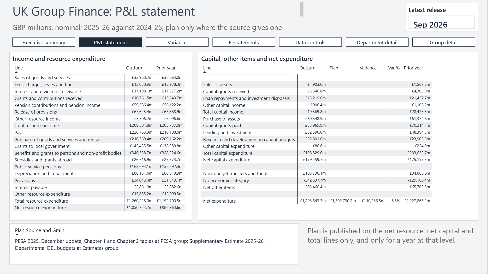

# UK Group Finance Reporting

What would UK central government look like if it reported like a corporate group? In this project I
treat government departments as business units and their arm's-length bodies as legal entities, and
build the management reporting a group finance team would expect: a P&L with variance to plan and
forecast, a balance sheet and cash flow for the NHS provider sub-group, and the workforce drivers
behind the cost base. The data are HM Treasury OSCAR II releases, NHS trust accounts, departmental
workforce files and HM Treasury and ONS deflators, and every reported total is meant to tie back to
its published source.

## Status

The project is built in phases:

0. Setup and gates
1. Ingestion and star schema
2. Core model and P&L
3. Performance, security, CI
4. Depth
5. Scale and finish

Phase 1 is done as a SQL Server database that one command rebuilds from the files in git: the 31 OSCAR
in-year releases and the Estimates and PESA plans, plus, with the larger source files, the annual restated
files, the PSS control and the OSCAR Plans. How it is built and tested is in [docs/pipeline.md](docs/pipeline.md),
and [docs/reconciliation.md](docs/reconciliation.md) shows how every load ties back to the published file,
including the differences I could not explain. Phase 2 has started: the semantic model skeleton is in
[model/](model/) (20 tables and 3 calculation groups, 21 relationships, the deflator and CPI queries in Power Query, the base
measures, the time-intelligence, scenario-comparison and display-unit calculation groups, the plan grain guard, real-terms measures and three
perspectives, with its metadata kept by Tabular Editor scripts in [te/](te/) and checked by a rule file in CI), described in
[docs/model.md](docs/model.md) and tested against the warehouse as described in [docs/model-testing.md](docs/model-testing.md).
The report is built: seven pages (executive summary, P&L statement, variance, restatements, data controls and two
drill-through pages), described page by page in [docs/pages.md](docs/pages.md), with every figure on a page equal to
a DAX test result ([evidence/report/screenshot_figures.csv](evidence/report/screenshot_figures.csv)).
Row-level and object-level security (two roles, an invented user map, 87 role cases compared with SQL) is in
[docs/security.md](docs/security.md).
The DAX test results are tied to the model by a hash ledger that CI checks, and the model's tables, measures and roles
are listed in a reference generated from the model itself: [docs/evidence.md](docs/evidence.md),
[docs/model-reference.md](docs/model-reference.md).
The source fetcher and file manifest are described in [docs/data-sources.md](docs/data-sources.md).

## The report

The other pages are in [screenshots/](screenshots/): restatements, data controls, the department detail and the group detail
(both reached by drill-through). Page by page, what each shows, the filters that are fixed and the test behind each figure are in
[docs/pages.md](docs/pages.md). The report is read by Power BI Desktop from the model in [model/](model/); there is no service
behind it.

## Data sources and licence

All source data are public sector information published under the Open Government Licence v3.0.
Sources, links and attribution are listed in [DATA_LICENCES.md](DATA_LICENCES.md). What is real,
what I wrote by hand and what is computed from real data is in the register below.

The code is released under the MIT licence; see [LICENSE](LICENSE).

## Register of real, authored, derived and synthetic data

Real data only in real totals. An object is one of four classes:

- **real**: a published number, loaded as it was published;
- **authored**: a table I wrote by hand because no source publishes it (a key, a name, a mapping); it holds no
  amount;
- **derived**: computed from real data by a stated rule or allocation (a regrouping, a monthly phasing); it is
  flagged as derived in the database wherever it could be mistaken for data, and never added to a real total;
- **synthetic**: invented data. There is one table, the map of invented users to departments that drives the security
  roles (`synthetic.user_department`, 11 rows, below). It holds no amount, only two views read it, and no real fact or
  total reads those. Nothing of this class may be added without its own file, a row here and a test. **Tested**:
  `pipeline/tests/test_register.py::test_the_synthetic_schemas_hold_exactly_the_registered_tables_and_no_fact_or_total_view_reads_them`
  (the `synthetic` and `scale` schemas hold exactly the registered tables, and the only objects that read them are the two
  role views, which nothing reads), `sql/tests/821_only_the_two_role_views_read_the_synthetic_table_and_nothing_reads_them.sql`
  and `pipeline/tests/test_synthetic.py` (the pinned totals of the real facts hold with the map loaded).

Every authored file is in the table. **Tested**: `pipeline/tests/test_register.py` fails if an `authored/*.csv`
file is missing from it, if the row count shown differs from the file, or if a row of class authored, derived or
synthetic does not say no to reaching a real total. The database labels every authored table in its description
(`sql/tests/200_authored_tables_are_labelled.sql`). Row counts are from a committed-scope build
(`evidence/build/table_counts.csv`); where a full-scope build differs it is shown in brackets.
The two CSV files under `te/` (`te/scripts/perspectives.csv` and `te/bpa/ignores.csv`) are metadata about the semantic
model, not data: they hold no amount, never reach the warehouse and are not in the table. The model's own authored tables are
labelled AUTHORED in their descriptions and in a display folder, and a rule of the analyzer fails the build if one is not
(`te/bpa/README.md`).

| Object or file | Class | Schema and table | Rows | What it holds | Can it reach a real total | Test |
|---|---|---|---|---|---|---|
| `authored/account_flow.csv` | authored | `authored.account_flow` | 12 | whether each economic category that the digit rule cannot settle is Expenditure, Income or Not applicable | no: a label on an account, no amount | `sql/tests/308_every_economic_category_has_one_budget_and_one_flow.sql` |
| `authored/current_structure_map.csv` | authored | `authored.current_structure_map` | 20 | the department a line belongs to in the current structure where the rules cannot decide: the review of the BEIS sub-segments, three lines left in DSIT, the departments that closed into another | no: it moves a line between departments, every line keeps its amount and the total is unchanged | `sql/tests/453_current_structure_authored_rows_are_live_unique_and_applied.sql`, `sql/tests/452_current_structure_current_totals_equal_reported_and_snapshot.sql` |
| `authored/department_name.csv` | authored | `authored.department_name` | 75 | the display name of each department number in each naming period, including the four Unallocated members | no: names and periods only | `sql/tests/203_department_periods_are_well_formed.sql`, `sql/tests/205_published_department_labels_belong_to_their_period.sql` |
| `authored/department_sr_group.csv` | authored | `authored.department_sr_group` | 63 | which Spending Review group a current department belongs to, one organisation exception (department 085) and the departments of the combined pre-2023 group | no: it decides which group a real line is added to; the regrouped lines add back to the fact exactly | `sql/tests/551_bridge_follows_the_authored_department_rule.sql`, `sql/tests/550_every_outturn_line_has_exactly_one_sr_group.sql` |
| `authored/organisation_key_override.csv` | authored | `authored.organisation_key_override` | 14 | the durable key a code gets where its three-letter prefix is not enough | no: a key, never an amount | `sql/tests/210_overrides_are_well_formed.sql`, `sql/tests/211_every_override_is_used.sql` |
| `authored/plan_name_map.csv` | authored | `authored.plan_name_map` | 97 | which plan member a published plan name belongs to, with confidence and evidence | no: a map of names; the plan amounts are the published ones | `sql/tests/505_plan_lines_all_mapped.sql`, `sql/tests/512_authored_data_never_reaches_a_total.sql` |
| `authored/plan_source.csv` | authored | `authored.plan_source` | 17 | each plan source and edition: its basis, whether it is the final plan, what it covers | no: descriptions of sources, no amount | `sql/tests/512_authored_data_never_reaches_a_total.sql` |
| `authored/sr_group.csv` | authored | `authored.sr_group` | 32 | the 23 Spending Review groups of the latest annual release, the Single Intelligence Account (plan only), the combined pre-2023 group, six non-department members and the outturn-only member for former department lines | no: names and types, no amount | `sql/tests/506_sr_group_members.sql`, `sql/tests/512_authored_data_never_reaches_a_total.sql` |
| `authored/statement_account_rule.csv` | authored | `authored.statement_account_rule` | 31 | which detail line of the income and expenditure statement each economic category is added to: rules on economic budget, flow, PESA group or category, the most specific rule winning | no: it decides which line a real amount is added to, and every account has exactly one line, so the statement total equals `Outturn` | `sql/tests/740_every_account_maps_to_exactly_one_statement_line.sql`, `sql/tests/741_the_statement_total_equals_outturn_in_every_year.sql` |
| `authored/statement_line.csv` | authored | `authored.statement_line` | 39 | the layout of the statement: line, order, type, the sign it is presented in, indent, the lines a subtotal adds up and the plan scope it is compared with | no: names, order and lists of lines; a subtotal is the sum of its members and a spacer has no amount | `sql/tests/742_a_subtotal_is_the_sum_of_its_members.sql`, `sql/tests/743_a_line_with_a_plan_scope_holds_exactly_the_accounts_of_that_budget.sql` |
| `dw.statement_line`, `dw.statement_line_member`, `dw.account_statement_line` | authored | the same three tables, resolved from the two statement files | 39; 110; 128 | the statement lines, every detail line each line adds up, and the detail line of each account | no: no amount column of any type | `sql/tests/745_the_statement_layout_is_authored_and_adds_no_amount.sql` |
| `dw.v_statement_pnl` | derived | a view over `dw.fact_outturn` and `dw.fact_plan` through the statement tables | one row per line and year with an amount or a plan | the statement computed in SQL, which the model's statement measures are tested against; the model never reads it | no: it reads the facts and writes nothing; its total line equals the sum of the fact in every year | `sql/tests/741_the_statement_total_equals_outturn_in_every_year.sql` |
| Model table `Statement Line` | authored | `dw.statement_line` through `dw.v_model_statement_line` | 39 | the statement layout as a dimension; Account is related to it | no: it holds no amount | `sql/tests/700_model_views_have_the_rows_of_their_base_tables.sql` |
| Model table `Statement Measure` (field parameter) | authored | none: a calculated table of four `NAMEOF` rows | 4 | the four statement measures a visual can switch between | no: it holds no amount and filters nothing | `tests/dax/750_statement_measure_parameter_rows.dax` |
| `authored.pss_sr_group_alias` (created in `sql/authored/400_pss_sr_group_alias.sql`) | authored | `authored.pss_sr_group_alias` | 3 (full scope only) | three names the Public Spending Statistics use for a Spending Review group that OSCAR writes differently | no: it decides which OSCAR group a PSS row is compared with, and holds no amount | `sql/tests/411_pss_sr_group_map_complete.sql` |
| the Unallocated department members | authored | `dw.dim_department` | 4 of 76 (U011, U035, U077, U084) | a home for the lines of a closed or split department that no current department took over (the Electoral Commission, the Assets Recovery Agency, Exiting the EU, the BEIS shared lines) | no: the member adds no amount; its lines are real outturn, counted once | `sql/tests/451_current_structure_unallocated_members_are_whole_and_exist.sql` |
| the Unallocated Spending Review members | authored | `dw.dim_sr_group` | 2 of 32 (`Unallocated central funds` for plans, `Unallocated: former department lines` for outturn) | two members that are not departments: funds the plans have not allocated, and the outturn lines of former departments. The first has no outturn line, the second has no plan row | no: neither adds an amount; no outturn line is in `Unallocated central funds` | `sql/tests/550_every_outturn_line_has_exactly_one_sr_group.sql`, `sql/tests/506_sr_group_members.sql` |
| `dw.outturn_sr_group_bridge` | derived | `dw.outturn_sr_group_bridge` | 5,480 | the Spending Review group of each organisation version and sub-segment pair, by the current department and the authored rule | no: a mapping that holds no amount | `sql/tests/550_every_outturn_line_has_exactly_one_sr_group.sql` |
| `dw.outturn_plan_line` and the plan-basis outturn tables | derived | `dw.outturn_plan_line`, `dw.outturn_plan_basis_inyear`, `dw.outturn_plan_basis_annual` | 101,675; 34,048; 1,020 (annual, full scope only) | real outturn regrouped to the plan's groups and measures | no: they add back to `dw.fact_outturn` in total and in every release and are not a second source of the number | `sql/tests/550_every_outturn_line_has_exactly_one_sr_group.sql`, `sql/tests/556_inyear_plan_basis_equals_the_fact_selection_at_every_release.sql` |
| `dw.plan_phasing_profile` | derived | `dw.plan_phasing_profile` | 8,988 (53,688 full scope) | twelve monthly shares per annual plan, from the prior year's outturn; not published | no: flagged `is_derived = 1`, described as DERIVED, and no real fact reads it | `sql/tests/558_nothing_derived_reaches_a_real_total.sql`, `sql/tests/552_profile_shares_sum_to_one_and_cover_twelve_periods.sql` |
| `dw.fact_plan_phased` | derived | `dw.fact_plan_phased` | 8,988 (53,688 full scope) | each plan row spread over the twelve months by its profile, scenario `Plan (phased)` | no: flagged `is_derived = 1`; the twelve months add to the plan exactly and no view, procedure or key points at it | `sql/tests/558_nothing_derived_reaches_a_real_total.sql`, `sql/tests/555_phased_plan_sums_to_the_plan_exactly.sql` |
| `dw.fact_outturn` | real | `dw.fact_outturn` | 658,554 | the revision deltas of the 31 in-year releases, GBP thousands | yes: this is the real outturn; its row count and sum are pinned in `evidence/expected/real_fact_totals.csv` | `pipeline/tests/test_real_totals.py`, `sql/tests/302_delta_total_equals_the_control_total.sql` |
| `dw.fact_plan` | real | `dw.fact_plan` | 749 (5,372 full scope) | the published plans: Estimates, PESA and, in full scope, OSCAR Plans | yes: published figures, grouped through the authored name map | `pipeline/tests/test_real_totals.py`, `sql/tests/509_fact_plan_ties_to_published_totals.sql` |
| `dw.fact_outturn_annual` | real | `dw.fact_outturn_annual` | 97,250 (full scope only) | the restated annual outturn of the November 2023, 2024 and 2025 releases | yes: published figures | `pipeline/tests/test_real_totals.py`, `sql/tests/404_bud_fact_sums_equal_excluding_closed.sql` |
| Model table `Fact Plan Phased (derived)` | derived | `dw.fact_plan_phased` through `dw.v_model_fact_plan_phased` | 53,688 | the model's copy of the phased plan; named, described and foldered as derived, with `Is Derived` and the method on every row | no: it is related to scenario Plan (phased), the model has no measure that adds it to Plan or Outturn, and the model tests count its rows apart from the real facts | `sql/tests/706_only_the_derived_model_view_reads_the_phased_plan.sql`, `pipeline/tests/test_model_files.py::test_derived_and_real_tables_are_labelled` |
| Model function `Basis.OutturnFor`, the rules for `NON_DEPT_AME`, `NON_BUDGET` and `UNCLASSIFIED` | authored | none: a rule inside the model (`functions.tmdl`) | 3 rules | which outturn lines each of three OSCAR Plans measures is compared with; `dw.plan_measure_selection` does not define them | no: it selects real outturn lines and holds no amount; the other seven rules are those of `dw.plan_measure_selection` | `tests/dax/735_outturn_plan_basis_other_measures.dax` |
| Model measure `Plan (phased)` | derived | reads the phased plan only | 1 measure | the phased plan summed for the plan rows `Plan` adds up | no: it is the only measure that names the phased table, `Outturn` and `Plan` never read it, and test 733 shows their totals equal their own facts | `pipeline/tests/test_model_measures.py::test_the_derived_phased_plan_is_read_by_one_measure_and_by_no_other`, `tests/dax/733_phased_plan_never_reaches_outturn_or_plan.dax` |
| Model member `No issue flagged` of `Data Quality Issue` | authored | `dw.v_model_data_quality` | 1 of 7 | a label, so that every outturn row has a data-quality key that exists | no: it holds no amount and flags no fact row | `sql/tests/703_model_data_quality_view_adds_only_the_no_issue_member.sql` |
| Model table `Deflator` (read over the web) | real | none: read in Power Query from the manifest links | 229 | HM Treasury GDP deflators (2025-26 = 100) for three vintages: the published index and per cent change, and a chained index in which a forecast year is the previous level moved by its published per cent change | yes, where a measure converts to real terms: the figures are published, and the chained forecast levels are arithmetic on published changes, marked by `Year Status`; real terms use one vintage | `tests/dax/703_deflators.dax` |
| Model table `CPI` (read over the web) | real | none: read in Power Query from the manifest links | 918 to September 2026 (more as ONS publishes) | ONS CPI index (D7BT) and annual rate (D7G7), monthly | yes, where a measure uses it: published figures | `tests/dax/704_cpi.dax` |
| `dw.department_reported_number` and the model column `Reported Department Numbers` | derived | `dw.department_reported_number` through `dw.v_model_department` | 63 | the department of the current structure that answers for each department number the outturn was reported under: its own number, an Unallocated member, or (for 027 only) the department that receives the lines | no: a mapping of numbers to departments; `reported_net_amount` is a note of what the number was reported with, no measure reads it, and the amounts of the as-reported structure added over the departments equal the total | `sql/tests/760_every_reported_department_number_has_exactly_one_current_department.sql`, `tests/dax/764_structure_totals_by_year.dax` |
| Model measures of the restatement and the current structure (display folders `Restatement` and `Current Structure`) | derived | none: measures over `Fact Outturn` | 15 | the outturn as at a release, as first reported, the revisions between releases, the figure under each department structure and the transfer between them | no: each is a sum, a difference or a ratio of the real deltas; the transfer adds to zero over the departments in every year and release | `tests/dax/760_as_at_release_equals_file_total.dax`, `tests/dax/764_structure_totals_by_year.dax`, `tests/dax/765_structure_totals_by_release.dax` |
| Model measures of real terms (display folder `Real Terms`) | derived | none: measures over `Fact Outturn`, `Fact Plan` and `Fact Plan Phased (derived)` | 7 | outturn, plan and statement amounts in 2025-26 prices: each financial year's amount times the index of 2025-26 over the index of that year, from the October 2026 Budget deflators; the phased twin is labelled DERIVED | no: each is a separate measure, the nominal measures and every real total are unchanged, and a year without an index gives BLANK, never the nominal figure | `tests/dax/770_real_terms_outturn_by_year.dax`, `tests/dax/773_real_terms_2025_26_is_nominal.dax`, `tests/dax/776_real_terms_year_without_index_is_blank.dax` |
| `synthetic/user_department.csv` | synthetic | `synthetic.user_department` | 11 | invented users (addresses at `example.org`) and the departments of the current structure each may see: eight users, one with two departments, one with three, one whose department has outturn in six of nine years; a ninth user, `nobody@example.org`, is in no row on purpose | no: it filters rows for the security roles and holds no amount; only `dw.v_model_user_department` and `dw.v_model_user_plan_group` read it and nothing reads those | `sql/tests/821_only_the_two_role_views_read_the_synthetic_table_and_nothing_reads_them.sql`, `pipeline/tests/test_synthetic.py`, `sql/tests/820_the_user_map_is_synthetic_labelled_and_has_the_cases_the_roles_are_tested_with.sql` |
| `dw.v_model_user_department` and `dw.v_model_user_plan_group` | synthetic | two views over `synthetic.user_department` | 11; 10 | one row per user and department, and one row per user and Spending Review group whose departments the user holds in full (the rule that decides which plan a user sees) | no: no amount column; no fact, view of a fact or measure reads them, the roles read them by key | `sql/tests/822_a_user_sees_the_plan_of_a_group_only_when_every_department_of_the_group_is_the_users.sql`, `sql/tests/823_the_named_users_see_the_groups_the_security_document_says.sql` |
| Model table `User Department (synthetic)` | synthetic | `dw.v_model_user_department` | 11 | the user map as a hidden model table; the two roles filter the department dimension by it | no: hidden, related to nothing, no amount; the unrestricted totals equal SQL with it loaded | `tests/dax/820_user_department_rows.dax`, `tests/dax/822_unrestricted_totals_with_the_user_map_loaded.dax` |
| Model table `User Plan Group (synthetic)` | synthetic | `dw.v_model_user_plan_group` | 10 | the groups whose plan each user may see, as a hidden model table; the two roles filter the plan facts by it | no: hidden, related to nothing, no amount; the unrestricted totals equal SQL with it loaded | `tests/dax/821_user_plan_group_rows.dax`, `tests/dax/822_unrestricted_totals_with_the_user_map_loaded.dax` |

## Tools

Power BI Desktop (PBIP with TMDL and PBIR), SQL Server 2022 Developer, Python, Tabular Editor 2,
DAX Studio.
