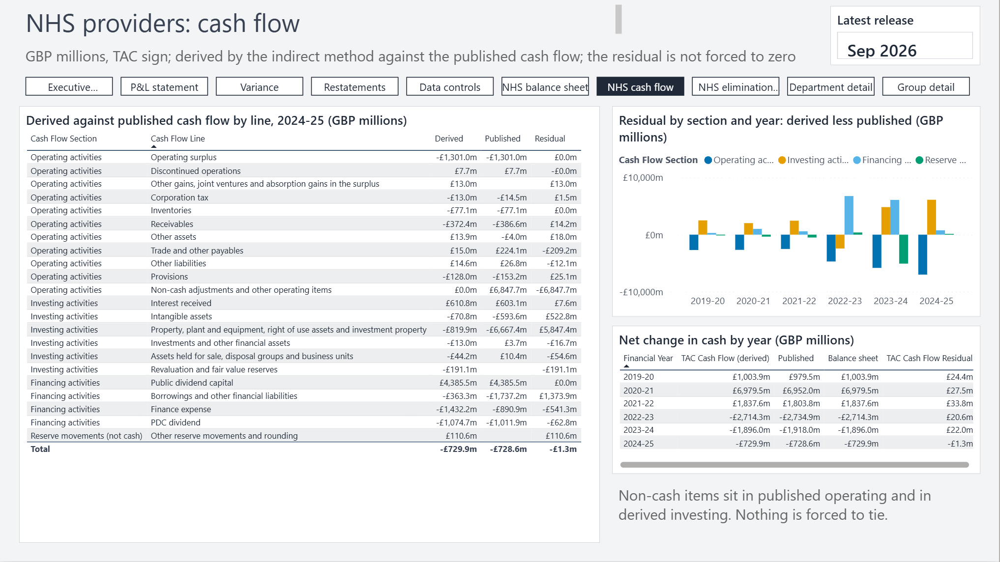
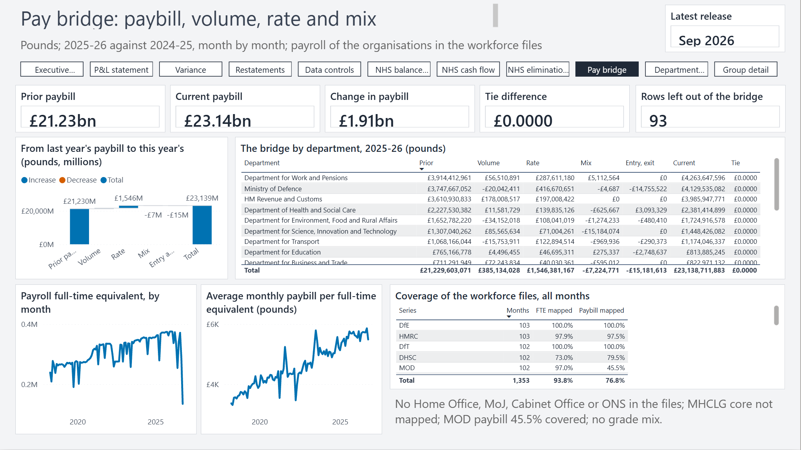

# The report pages

`model/UKGroupFinance.Report` is the report that reads the semantic model in `model/UKGroupFinance.SemanticModel` (PBIR, thick
report, Power BI Desktop only). It has eleven pages at 1280 x 720: nine that you navigate to and two that you reach by
drill-through. Every claim below is labelled **tested** (with the command and the file that holds the result) or **designed**.

How it was made: every page was built with the `pbir` CLI, by the commands in [tools/build_report.sh](../tools/build_report.sh), and
no report file was edited by hand. One theme (`ukfr-finance`, an accessible Okabe-Ito palette, Segoe UI, no shadows, square
borders) carries the formatting; the exceptions are the card and table settings that `pbir` writes on the visual. Amounts show in
billions or millions through the `Display Unit` calculation group, set by a fixed page filter, and never through a `,,` format
string. Nothing on a page is a slicer selection, a bookmark or a synced slicer: every fixed state is a page or visual filter with
its values written in the file.

## How the figures are checked

- Each data visual has a DAX test in `tests/dax/78x_*` or `79x_*` that returns the figures it shows, in the same filter context, and an
  independent SQL (or Python) expectation over `dw` and `audit` in `tests/expected/`. **Tested**: `tools\run_dax_tests.ps1 -Refresh`,
  `ukfr dax-compare`: 77 of 77 tests passed for the first seven pages, 22 of them new; with the NHS trust accounts pages the suite is 98 of 98 (`evidence/model/dax_tests.csv`).
- I read the displayed figures off the cropped screenshots myself and wrote them to
  [evidence/report/screenshot_figures.csv](../evidence/report/screenshot_figures.csv): 168 figures (120 on the first seven pages, 28 on the three NHS pages, 20 on the pay bridge page), each with its page, visual,
  label, the figure as displayed, the test, the row of the test result and how it is displayed (divisor and decimals).
  **Tested**: `pipeline/tests/test_report_evidence.py` rounds the test result as displayed, half up, and compares: all 168 are equal
  (`uv run --project pipeline pytest pipeline/tests/test_report_evidence.py`: 150 passed). A text figure (a plan badge, a status) must
  equal the test result or start with it where the visual cuts the text off.
- Screenshots are in [screenshots/](../screenshots/), one for each page, made with `tools/crop_screenshots.ps1`: `pbir desktop
  screenshot` at scale 2 after a refresh and a wait, cropped to the page canvas (2034 x 1144), so no title bar, account name or path is
  in an image. **Tested**: the same pytest file checks that the ten files exist and have the same size. The two drill-through pages
  are captured without a selection, so they show all departments and all groups; reached from a department or a group they open
  filtered to it. I did not click through a drill-through, and that click is **designed**, not run.
- `pbir validate --all`: valid, 119 visuals, 132 advisory warnings (below). `pbir bpa run`: passed, 0 errors, 124 warnings, 30 rules, 242
  objects, listed in [evidence/report/pbir_bpa.csv](../evidence/report/pbir_bpa.csv).
- CI (`report-checks`) runs Fab Inspector with the rules in `tests/report/report-rules.json` on the real report and keeps a negative
  control that must fail (`tests/report/report-rules-negative.json`), gating on the JSON output.

## The pages

**The plan filter.** One report-level filter keeps the plan measures resource DEL excluding depreciation and capital DEL (`Fact Plan[Plan Measure]`; `tools/build_report.sh report_filters`), so every plan figure on a page is DEL, the voted limits. Departmental AME is a forecast and the in-year outturn of AME is a first look, so an AME variance is a different quantity; it is reconciled on the Variance page and left out of the headline. With every measure the first version of the report led with -8.5% in 2025-26; the DEL figure is -1.3% (`docs/reconciliation.md`, section 9).

Each page has the same header: the title, a subtitle that states the basis (unit, nominal or real terms, structure, year), the latest
release in the model (measure `Latest Release in View`) and the page navigator. Each plan figure sits beside the plan badge, a table of the
measure `Plan Source and Grain`, which names the plan source and the grain it is published at for the year in view (test 785); a plan
below its grain is BLANK by the model's grain guard, never a coarse plan repeated.

### 1. Executive summary

- **Fixed**: page filter `Display Unit` = GBP billions; each visual carries its own financial-year filter.
- **Row 1**, financial year 2025-26 as the latest release states it: outturn of all budgets (`Outturn`), DEL outturn on the plan's basis,
  the DEL plan, the variance and the variance % (`Comparison Amount` with the `Scenario Comparison` item Actual, Variance, Variance % fixed on
  the visual) and outturn in 2025-26 prices (`Outturn (real terms)`): 637.49bn, 645.98bn, -8.50bn and -1.3%. Test 788.
- **Row 2**, 2026-27 year to date to June 2026 (period 3), against the phased plan: `Outturn (plan basis)`, `Plan (phased)`, `Variance to
  Phased Plan`, its percentage and `Outturn (real terms)`, with `Time Intelligence` = YTD, period 3. The plan and the phased plan are DEL (159.80bn against 156.63bn, +3.17bn, +2.0%; with AME it was -2.6%). The September 2026 release
  reports to June 2026, not September, so the year to date stops at period 3 (test 786: periods 3 and 6 give the same outturn). The phased plan
  is my allocation of the annual plan and is labelled derived on the page and in the measure.
- **Charts**: outturn by year, nominal and in 2025-26 prices, 2018-19 to 2025-26 (test 789); the ten largest departments of the current
  structure in 2025-26, a Top N filter (test 790); DEL, AME and non-budget (test 791). The charts show no data labels, so only the cards
  are in the figures file.
- Departments are not a drill-through button here: a right-click on a bar opens Department detail (**designed**; the Variance page has buttons).

### 2. P&L statement

- **Fixed**: financial year 2025-26, GBP millions.
- The 39 lines of the statement (subtotals, totals and three spacer rows with their own zero-width labels, `show-all` on rows) are two matrices that
  split after net resource expenditure, because 39 rows do not fit one matrix at a readable size. Both show the amount and the prior year
  (`Statement Amount`, `Statement Amount PY (OFFSET)`). **The plan columns are gone**: the plan exists only for the net lines and the total, and the total
  adds DEL limits to an AME forecast (a variance of -110.24bn, -8.5% in 2025-26), which is a mismatch of bases and not an underspend. The measures
  `Statement Plan` and `Statement Variance` remain in the model and are tested (792), but no visual shows them.
  Column headings are shortened with `pbir fields rename` (display names of the visual's fields only).
- **Tested**: test 792 returns every line (36 rows, plan and variance included) and ties to `dw.v_statement_pnl`; the amount and prior-year figures of the lines shown are in the figures file
  and equal the test. The field `Statement Measure` (a field parameter) is not on a visual: `pbir` cannot author one, so each column is a fixed measure.

### 3. Variance

- **Fixed**: financial year 2024-25 (the year at the Spending Review group grain with a full outturn), GBP billions.
- DEL only (the report filter). The native waterfall has Scenario as its category and the Spending Review group as its breakdown (measure `Plan and Outturn by Scenario`,
  test 793). It reads as a bridge from outturn to plan by group; the largest steps are the Single Intelligence Account (a plan with no outturn in OSCAR), Defence and Business and Trade, and Home Office goes the other way (its in-year outturn lacks fee income).
- The bar chart shows the variance % by group with the model's favourable/adverse colouring (a conditional-format rule on the value: above zero
  is the theme's `bad`, otherwise `good`; blue and orange, not red and green).
- **The decomposition tree is gone.** It opened collapsed and showed one number, and the plan measures it split by were mostly AME. In its place is the reconciliation table
  (model table `Plan Variance Check`, from `audit.plan_variance_reconciliation`): the 2024-25 variances that are explained, fixed or unexplained, DEL and AME, in GBP thousands, with the verdict and its reason.
  The verdict text is cut off at the cell edge in the capture; the full text is in `evidence/full/plan_variance_reconciliation.csv`. Test 800 returns every row of the table (364) and the three
  figures and one verdict I read off the capture are in the figures file (**tested**). The cell counts by verdict are in `docs/reconciliation.md`, section 9.
- **A change from my first design**: I had planned department as the breakdown and control budget below it. Plan is published by Spending
  Review group, so any department or control budget selection is below the plan's grain and `Plan` is BLANK (test 723). The page uses the group and says so.
- Buttons for the two drill-through pages (greyed in a capture, because nothing is selected).

### 4. Department detail (drill-through)

- **Drill-through** on `Department (current structure)[Department]`, Back button. **Fixed**: 2025-26, GBP millions.
- Outturn by month (`Outturn (current structure)` by `Fiscal Period[Period]`; test 795), the year to date at period 12, as first reported, the revision since first reported and its
  percentage (test 797), and the ten largest organisations (test 796).
- **No plan here, and why**: I had planned monthly outturn against the phased plan on this page. `Plan (phased)` is BLANK when a department is selected, because the
  plan is not published below the Spending Review group (the grain guard, test 723). The page says so and points at Group detail.

### 5. Group detail (drill-through)

- **Drill-through** on `Spending Review Group[Spending Review Group]`, Back button. **Fixed**: 2025-26, GBP millions.
- Monthly outturn on the plan's basis against the phased plan (`Plan (phased)`, labelled derived in the title, the subtitle and the measure), the year to date at period 12 and the
  variance to it (`Variance to Phased Plan`), a table by month, and the plan badge. DEL only (the report filter): with every group in view the year is 637,487.3m against a phased plan of 645,984.2m, -8,496.9m or -1.3%, where the same page with AME had a derived plan of 1,302,730.2m and a month-one variance of -39,498.0m. Tests 794 and 788.
- This page is the one place the model compares a monthly outturn with a plan, and the plan it uses is mine.

### 6. Restatements

- **Fixed**: GBP billions; the three cards are fixed to the March 2026 release and 2025-26.
- Net change each release made (`Revision in Release`) and the part that restated earlier figures (`Restatement in Release`), by release (test 798); gross restatement
  with and without flagged rows (`Gross Restatement in Release` and its `(excl. flagged)` variant; tests 763, 798); the data-quality findings (`Data Quality Issue`, rules a to d, test 787);
  the outturn of 2025-26 as the March 2026 release stated it, as first reported and the revision between them (test 799).
- The page says what "as at a release" (the outturn that release stated) and "as first reported" (the first amount each line and month had) mean.
- Flagged rows: the NHS Pension Scheme unit error and its offsetting line are both flagged (nine findings, thirteen flagged rows), so the excluding variant
  leaves out both halves: the gross restatement of December 2023 falls from 8,645bn to 13.9bn (`docs/model.md`).

### 7. Data controls

- Amounts in GBP thousands. The tables list the audit tables the build writes, through five model tables labelled audit and control (`docs/model.md`).
- File controls (31 releases): rows read, loaded, quarantined, the exact sum of the file, the four-decimal file total, the model's as-at outturn of the release's year and their difference, which is 0 in every row
  (test 780). In-year outturn against the restated annual files for DEL (test 781, 60 rows before the filter). The Public Spending Statistics against OSCAR on the
  annual-file basis for the total excluding Scotland, sorted so that the two known failures come first: capital DEL in 2023-24 (-0.46%) and 2024-25 (-0.36%) against a tolerance of
  0.1% (test 782; cause unknown, pinned by `sql/tests/412`). Plan coverage (test 783). Rows read, loaded and quarantined by source family, and the web quarantine count, 0 (test 784).
- A table that is longer than its visual scrolls; the screenshot shows the first rows.

### 8. NHS balance sheet

- **Fixed**: 2024-25 on every visual that is a point in time, GBP millions, TAC sign. The page shows the **sum of the provider accounts**, not the consolidated accounts (the next but one page compares them).
- Six cards: the closing balance of the four blocks of the balance sheet, total assets employed as published and the number of providers with statements. A matrix by block gives, for 2024-25, the closing balance, the opening balance as the file of the year restated it, the closing balance of the year before as that file published it, their difference and the restatement (the values both files hold that differ by GBP 1,000 or more). A column chart gives the restatement of opening net assets by year, one more gives total assets at each year end, a line the providers with statements, and a table the providers that stop reporting with their last year and successor.
- **Tested**: tests 152 (closing balance and providers by year and block), 153 (opening, prior-year closing, difference, restatement), 154 (restatement against `audit.tac_prior_year_summary`), 155 and 156 and 157 (a balance over a span is the last year; a provider that has gone adds nothing to later years); the 6 card figures are in the figures file and equal test 152.
- The matrix is by block because the 40 lines of the balance sheet do not fit a readable table beside the charts; the lines are in the model and in test 158.

### 9. NHS cash flow

- **Fixed**: 2024-25 in the table, 2019-20 to 2024-25 in the chart and the net-change table; GBP millions, an inflow is positive.
- The table sets, for each of the 22 lines of the derived (indirect) cash flow, the derived amount, the published lines it is compared with and the residual, with the total row; the chart shows the residual by section and year; the second table gives the net change in cash by year (derived, published, balance sheet movement, residual).
- 2024-25 reads: the operating surplus, inventories and public dividend capital tie to the pound (residual 0); the non-cash adjustments the published cash flow adds back (+6,847.7) have no counterpart in the two primary statements, so the operating residual is -6,997 and the investing residual +6,115 (property, plant and equipment +5,847.4). The net change is -729.9 derived against -728.6 published and -729.9 on the balance sheet. The residual is not forced to zero and the page says so.
- **Tested**: tests 159 (22 lines x 6 years), 160 (sections) and 161 (net change); 14 figures in the figures file equal them. The tie of the published cash flow to itself and to the balance sheet is in `audit.tac_cash_flow_tie` and `sql/tests/151`, `152`.

### 10. NHS elimination control

- **Fixed**: 2024-25 on the cards and the keyed values; every year on the gap table and chart; GBP millions, TAC sign.
- Four cards (the gap in operating income, operating expenses, total assets and cash), a table of the six control lines for each of the six years (provider sum, consolidated, gap, gap %), a line chart of the gap as a share of the consolidated figure and the eight values keyed for 2024-25 with their printed and PDF pages. The consolidated figures are **authored** (hand-keyed from the published report); the gap is a difference, never a sum.
- The gap table is longer than its visual and scrolls: the screenshot shows the first 27 of its 36 rows; the figures are in test 162.
- **Tested**: test 162 (36 cells against the provider lines and the keyed values), 163 (the keyed values stay out of real totals); 8 figures in the figures file equal 162. The keyed values are checked in `sql/tests/156`.

## Design alternatives chosen, and what I dropped

| Wanted | What I did | Why |
|---|---|---|
| Synced slicers, state bookmarks | page and visual filters with fixed values; page buttons | `pbir` cannot author them (`docs/spikes/pbir_coverage.md`) |
| Field parameter switching a visual | fixed measures in fixed visuals | `pbir` cannot author a field parameter on a visual |
| Expanded decomposition tree | opens collapsed, the page says so | no `pbir` command writes the expansion state |
| Department variance and department phased plan | Spending Review group on the Variance and Group detail pages | the plan grain guard: no plan below the group |
| One statement matrix | two matrices | 39 rows do not fit at a readable size |
| Text boxes in a small font | 14 point text boxes | `pbir set` writes a text box's paragraphs as a string; only `pbir add title` and `add subtitle` write valid ones, at 24 and 14 points |
| One visual calculation on a table | dropped | matrix visual calculations do not render (`docs/spikes/pbir_coverage.md`) and no page needed one |
| Image, map and Q and A visuals | none | out of scope; CI rejects them |
| Tab order, mobile layout | not set | `pbir` cannot set a tab order; the mobile layout is **designed, not run** |

### 11. Pay bridge

- **Fixed**: 2025-26 against 2024-25 on the cards, the waterfall and the department table (a visual filter on the year); every month on the two trend charts; every series and month on the coverage table. Amounts are pounds (the model's other pages are GBP thousands), so the cards show billions through the card's own automatic unit and the waterfall millions through its label unit; no `Display Unit` item is involved.
- Five cards (prior paybill £21.23bn, current £23.14bn, change £1.91bn, the tie difference £0.0000 (an identity, shown so that the bridge visibly adds up; it is not a test of the volume) and the 93 department-organisation-month rows left out of the bridge in the year), a native waterfall (prior paybill, volume, rate, mix, entry and exit, and the waterfall's own total bar, which is the current paybill), a table of the bridge by department with the group's own total row (the total row's volume and mix are not the sums of the rows above; see the model page), the full-time equivalent and the average monthly paybill per full-time equivalent by month, and the coverage table of the workforce files with a text box for what is not covered.
- The month axis of the two trend charts is the first day of the month from `Fiscal Period`; the fiscal period is the model's time dimension, so a fiscal year filter would apply. The full-time equivalent line falls at the end because the latest month (October 2026) has the fewest departments with a valid cell (9, against 17 to 19 in the three months before it); it is a change in who has published, not in the workforce.
- The department table and the coverage table scroll (the screenshot shows the first eight and five rows); the figures are in tests 909 and 905.
- **Tested**: tests 910 (cards), 906 (waterfall steps), 902 (group by year, the table's total row), 909 (the departments), 908 (coverage total), 903 and 904 (the trend measures), 901 (the latest three months); 20 figures in the figures file equal them. The waterfall's deltas are small beside the 21bn base, which is why the bars have data labels.
- The page needs the full-scope database (the bridge reads `dw.workforce_month`).

## What the validators say

`pbir validate --all` gives 148 advisory warnings and no error (the seven first pages gave 92; the NHS pages add 40, the pay bridge page 16, of the same kinds): 53 visuals under the recommended size (the cards are 192 x 92 pixels, on purpose, so that six sit in a row),
58 visual-level filters (a card must fix its own year, scenario item or period; a page filter cannot differ between cards on one page), 10 text boxes under the height floor for
their text, 10 visuals with more than four fields (the statement matrices, the tables of controls and the NHS tables) and one page with more than fifteen visuals (the executive summary).
`pbir bpa run` raises the same findings (139 warnings, 30 rules, 265 objects) and two `PBIR_SHOW_ALL_ITEMS` for the statement's spacer rows, which need `show-all` to exist. I did not ignore
any rule; the list is in `evidence/report/pbir_bpa.csv`.

## Things I could not do or check

- I did not click: the drill-through (right-click and buttons), the page navigator, and the decomposition tree's expansion are **designed**; the pages render and the files validate.
- The data controls page needs the full-scope database (three of its tables read audit tables that exist only after a full build).
- The report was captured on one machine in one session; the figures file says what I read, and the tests say what the model returns. They agree on all 168 figures.
