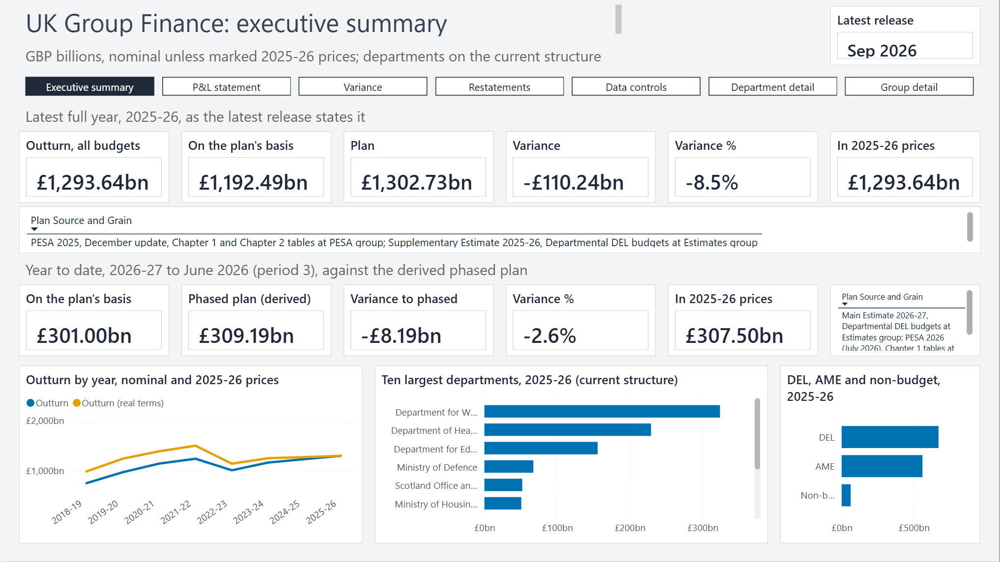
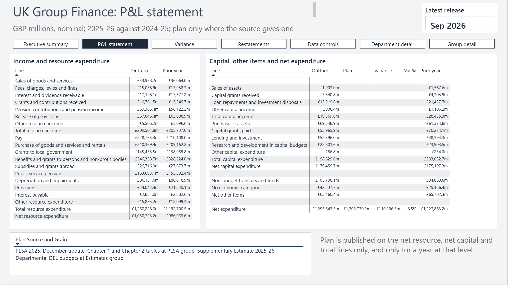
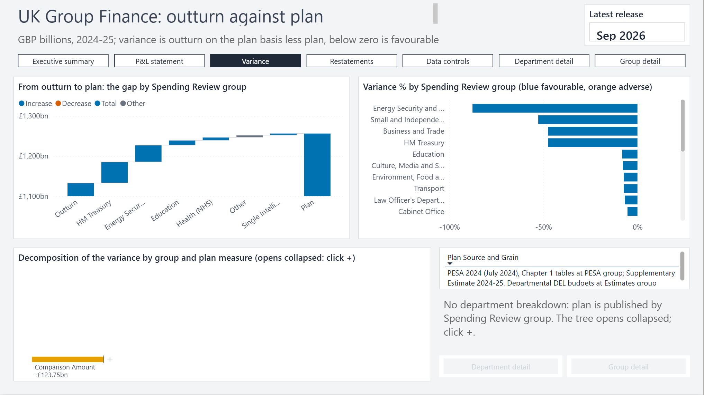
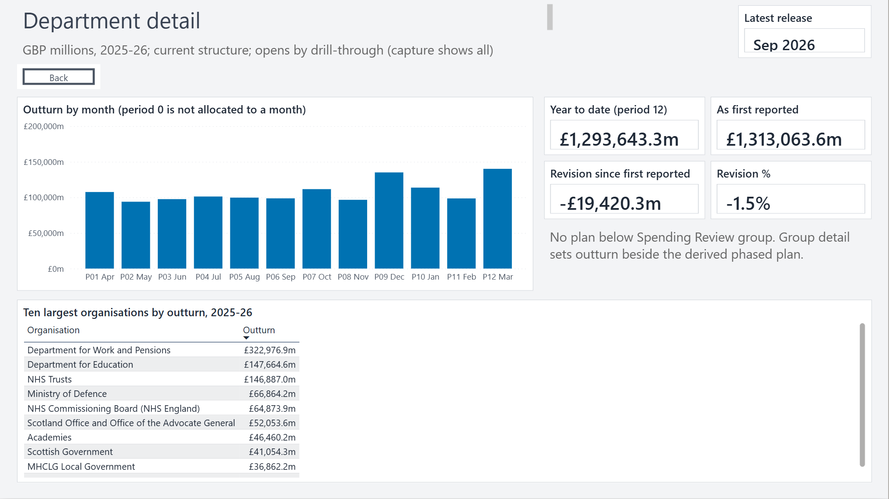
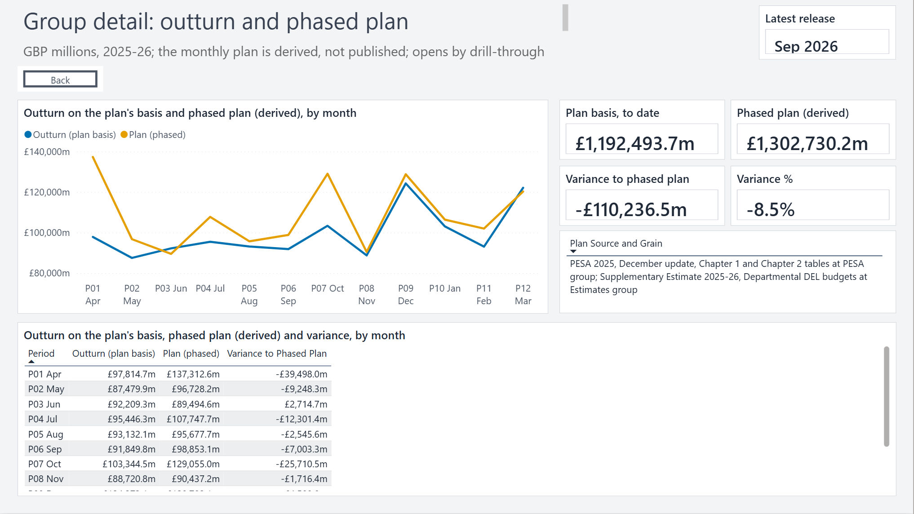
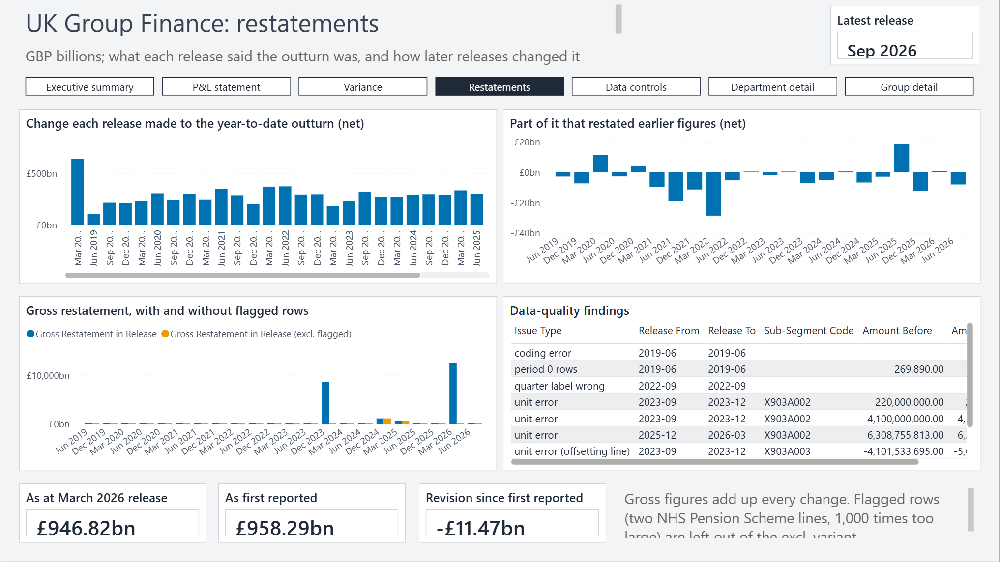
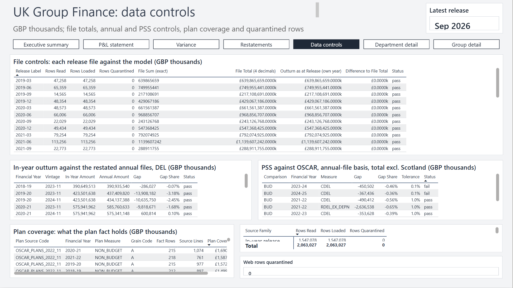

# The report pages

`model/UKGroupFinance.Report` is the report that reads the semantic model in `model/UKGroupFinance.SemanticModel` (PBIR, thick
report, Power BI Desktop only). It has seven pages at 1280 x 720: five that you navigate to and two that you reach by
drill-through. Every claim below is labelled **tested** (with the command and the file that holds the result) or **designed**.

How it was made: every page was built with the `pbir` CLI, by the commands in [tools/build_report.sh](../tools/build_report.sh), and
no report file was edited by hand. One theme (`ukfr-finance`, an accessible Okabe-Ito palette, Segoe UI, no shadows, square
borders) carries the formatting; the exceptions are the card and table settings that `pbir` writes on the visual. Amounts show in
billions or millions through the `Display Unit` calculation group, set by a fixed page filter, and never through a `,,` format
string. Nothing on a page is a slicer selection, a bookmark or a synced slicer: every fixed state is a page or visual filter with
its values written in the file.

## How the figures are checked

- Each data visual has a DAX test in `tests/dax/78x_*` or `79x_*` that returns the figures it shows, in the same filter context, and an
  independent SQL (or Python) expectation over `dw` and `audit` in `tests/expected/`. **Tested**: `tools\run_dax_tests.ps1 -Refresh`,
  `ukfr dax-compare`: 75 of 75 tests pass, 20 of them new (`evidence/model/dax_tests.csv`).
- I read the displayed figures off the cropped screenshots myself and wrote them to
  [evidence/report/screenshot_figures.csv](../evidence/report/screenshot_figures.csv): 121 figures, each with its page, visual,
  label, the figure as displayed, the test, the row of the test result and how it is displayed (divisor and decimals).
  **Tested**: `pipeline/tests/test_report_evidence.py` rounds the test result as displayed, half up, and compares: all 121 are equal
  (`uv run --project pipeline pytest pipeline/tests/test_report_evidence.py`: 123 passed). A text figure (a plan badge, a status) must
  equal the test result or start with it where the visual cuts the text off.
- Screenshots are in [screenshots/](../screenshots/), one for each page, made with `tools/crop_screenshots.ps1`: `pbir desktop
  screenshot` at scale 2 after a refresh and a wait, cropped to the page canvas (2034 x 1144), so no title bar, account name or path is
  in an image. **Tested**: the same pytest file checks that the seven files exist and have the same size. The two drill-through pages
  are captured without a selection, so they show all departments and all groups; reached from a department or a group they open
  filtered to it. I did not click through a drill-through, and that click is **designed**, not run.
- `pbir validate --all`: valid, 86 visuals, 92 advisory warnings (below). `pbir bpa run`: passed, 0 errors, 87 warnings, 30 rules, 167
  objects, listed in [evidence/report/pbir_bpa.csv](../evidence/report/pbir_bpa.csv).
- CI (`report-checks`) runs Fab Inspector with the rules in `tests/report/report-rules.json` on the real report and keeps a negative
  control that must fail (`tests/report/report-rules-negative.json`), gating on the JSON output.

## The pages

Each page has the same header: the title, a subtitle that states the basis (unit, nominal or real terms, structure, year), the latest
release in the model (measure `Latest Release in View`) and the page navigator. Each plan figure sits beside the plan badge, a table of the
measure `Plan Source and Grain`, which names the plan source and the grain it is published at for the year in view (test 785); a plan
below its grain is BLANK by the model's grain guard, never a coarse plan repeated.

### 1. Executive summary

- **Fixed**: page filter `Display Unit` = GBP billions; each visual carries its own financial-year filter.
- **Row 1**, financial year 2025-26 as the latest release states it: outturn of all budgets (`Outturn`), outturn on the plan's basis,
  the plan, the variance and the variance % (`Comparison Amount` with the `Scenario Comparison` item Actual, Variance, Variance % fixed on
  the visual) and outturn in 2025-26 prices (`Outturn (real terms)`). Test 788.
- **Row 2**, 2026-27 year to date to June 2026 (period 3), against the phased plan: `Outturn (plan basis)`, `Plan (phased)`, `Variance to
  Phased Plan`, its percentage and `Outturn (real terms)`, with `Time Intelligence` = YTD, period 3. The September 2026 release
  reports to June 2026, not September, so the year to date stops at period 3 (test 786: periods 3 and 6 give the same outturn). The phased plan
  is my allocation of the annual plan and is labelled derived on the page and in the measure.
- **Charts**: outturn by year, nominal and in 2025-26 prices, 2018-19 to 2025-26 (test 789); the ten largest departments of the current
  structure in 2025-26, a Top N filter (test 790); DEL, AME and non-budget (test 791). The charts show no data labels, so only the cards
  are in the figures file.
- Departments are not a drill-through button here: a right-click on a bar opens Department detail (**designed**; the Variance page has buttons).

### 2. P&L statement

- **Fixed**: financial year 2025-26, GBP millions.
- The 39 lines of the statement (subtotals, totals and three spacer rows with their own zero-width labels, `show-all` on rows) are two matrices that
  split after net resource expenditure, because 39 rows do not fit one matrix at a readable size. The left has the amount and the prior year
  (`Statement Amount`, `Statement Amount PY (OFFSET)`); no line of it has a plan in 2025-26, so it has no plan columns. The right has the
  amount, `Statement Plan`, `Statement Variance`, `Statement Variance %` and the prior year. The plan exists only for the net lines and the total
  (the source gives the plan at that level), so only the last row of the right matrix has one: plan 1,302,730.2m, variance -110,236.5m, -8.5%.
  Column headings are shortened with `pbir fields rename` (display names of the visual's fields only).
- **Tested**: test 792 returns every line (36 rows) and ties to `dw.v_statement_pnl`; nine lines, both columns, and the total row are in the figures file
  and equal the test. The field `Statement Measure` (a field parameter) is not on a visual: `pbir` cannot author one, so each column is a fixed measure.

### 3. Variance

- **Fixed**: financial year 2024-25 (the year at the Spending Review group grain with a full outturn), GBP billions.
- The native waterfall has Scenario as its category and the Spending Review group as its breakdown (measure `Plan and Outturn by Scenario`,
  test 793). It reads as a bridge from outturn to plan by group; the groups with the largest gap are HM Treasury and Energy Security and Net Zero.
- The bar chart shows the variance % by group with the model's favourable/adverse colouring (a conditional-format rule on the value: above zero
  is the theme's `bad`, otherwise `good`; blue and orange, not red and green).
- The decomposition tree explains the variance by Spending Review group and then by plan measure. It opens collapsed (`pbir` cannot write an expanded
  state), so the capture shows the root, -123.75bn, which is test 786's 2024-25 variance (**tested**); the page says to click +.
- **A change from my first design**: I had planned department as the breakdown and control budget below it. Plan is published by Spending
  Review group, so any department or control budget selection is below the plan's grain and `Plan` is BLANK (test 723). The page uses the group and says so.
- Buttons for the two drill-through pages (greyed in a capture, because nothing is selected).

### 4. Department detail (drill-through)

- **Drill-through** on `Department (current structure)[Department]`, Back button. **Fixed**: 2025-26, GBP millions.
- Outturn by month (`Outturn (current structure)` by `Fiscal Period[Period]`; test 795), the year to date at period 12, as first reported, the revision since first reported and its
  percentage (test 797), and the ten largest organisations (test 796).
- **No plan here, and why**: I had planned monthly outturn against the phased plan on this page. `Plan (phased)` is BLANK when a department is selected, because the
  plan is not published below the Spending Review group (the grain guard, test 723). The page says so and points at Group detail.

### 5. Group detail (drill-through)

- **Drill-through** on `Spending Review Group[Spending Review Group]`, Back button. **Fixed**: 2025-26, GBP millions.
- Monthly outturn on the plan's basis against the phased plan (`Plan (phased)`, labelled derived in the title, the subtitle and the measure), the year to date at period 12 and the
  variance to it (`Variance to Phased Plan`), a table by month, and the plan badge. Tests 794 and 788.
- This page is the one place the model compares a monthly outturn with a plan, and the plan it uses is mine.

### 6. Restatements

- **Fixed**: GBP billions; the three cards are fixed to the March 2026 release and 2025-26.
- Net change each release made (`Revision in Release`) and the part that restated earlier figures (`Restatement in Release`), by release (test 798); gross restatement
  with and without flagged rows (`Gross Restatement in Release` and its `(excl. flagged)` variant; tests 763, 798); the data-quality findings (`Data Quality Issue`, rules a to d, test 787);
  the outturn of 2025-26 as the March 2026 release stated it, as first reported and the revision between them (test 799).
- The page says what "as at a release" (the outturn that release stated) and "as first reported" (the first amount each line and month had) mean.
- Flagged rows: the NHS Pension Scheme unit error and its offsetting line are both flagged (nine findings, thirteen flagged rows), so the excluding variant
  leaves out both halves: the gross restatement of December 2023 falls from 8,645bn to 13.9bn (`docs/model.md`).

### 7. Data controls

- Amounts in GBP thousands. The tables list the audit tables the build writes, through five model tables labelled audit and control (`docs/model.md`).
- File controls (31 releases): rows read, loaded, quarantined, the exact sum of the file, the four-decimal file total, the model's as-at outturn of the release's year and their difference, which is 0 in every row
  (test 780). In-year outturn against the restated annual files for DEL (test 781, 60 rows before the filter). The Public Spending Statistics against OSCAR on the
  annual-file basis for the total excluding Scotland, sorted so that the two known failures come first: capital DEL in 2023-24 (-0.46%) and 2024-25 (-0.36%) against a tolerance of
  0.1% (test 782; cause unknown, pinned by `sql/tests/412`). Plan coverage (test 783). Rows read, loaded and quarantined by source family, and the web quarantine count, 0 (test 784).
- A table that is longer than its visual scrolls; the screenshot shows the first rows.

## Design alternatives chosen, and what I dropped

| Wanted | What I did | Why |
|---|---|---|
| Synced slicers, state bookmarks | page and visual filters with fixed values; page buttons | `pbir` cannot author them (`docs/spikes/pbir_coverage.md`) |
| Field parameter switching a visual | fixed measures in fixed visuals | `pbir` cannot author a field parameter on a visual |
| Expanded decomposition tree | opens collapsed, the page says so | no `pbir` command writes the expansion state |
| Department variance and department phased plan | Spending Review group on the Variance and Group detail pages | the plan grain guard: no plan below the group |
| One statement matrix | two matrices | 39 rows do not fit at a readable size |
| Text boxes in a small font | 14 point text boxes | `pbir set` writes a text box's paragraphs as a string; only `pbir add title` and `add subtitle` write valid ones, at 24 and 14 points |
| One visual calculation on a table | dropped | matrix visual calculations do not render (`docs/spikes/pbir_coverage.md`) and no page needed one |
| Image, map and Q and A visuals | none | out of scope; CI rejects them |
| Tab order, mobile layout | not set | `pbir` cannot set a tab order; the mobile layout is **designed, not run** |

## What the validators say

`pbir validate --all` gives 92 advisory warnings and no error: 40 visuals under the recommended size (the cards are 192 x 92 pixels, on purpose, so that six sit in a row),
38 visual-level filters (a card must fix its own year, scenario item or period; a page filter cannot differ between cards on one page), 7 text boxes under the height floor for
their text, 6 visuals with more than four fields (the statement matrices and the tables of controls) and one page with more than fifteen visuals (the executive summary).
`pbir bpa run` raises the same findings (87 warnings) and two `PBIR_SHOW_ALL_ITEMS` for the statement's spacer rows, which need `show-all` to exist. I did not ignore
any rule; the list is in `evidence/report/pbir_bpa.csv`.

## Things I could not do or check

- I did not click: the drill-through (right-click and buttons), the page navigator, and the decomposition tree's expansion are **designed**; the pages render and the files validate.
- The data controls page needs the full-scope database (three of its tables read audit tables that exist only after a full build).
- The report was captured on one machine in one session; the figures file says what I read, and the tests say what the model returns. They agree on all 121 figures.
